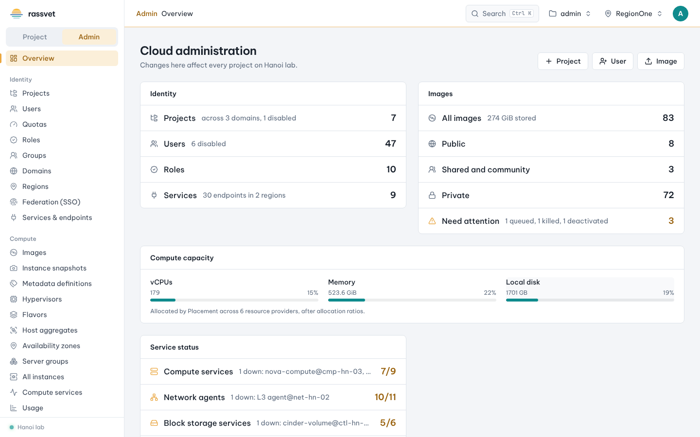

# The admin view

## Use case

You operate the cloud. You need a cloud-wide picture — every project, user, image, hypervisor and network —
and the tools to manage them, separate from the project you happen to work in.

## Switch to the admin view

Users with the `admin` role see a **Project / Admin** switch at the top of the left menu.

1. Click **Admin**. The menu changes to the admin pages and the top bar gets an amber line and the word
   *Admin*, so you always know that changes affect every project.
2. Click **Project** to go back to your own project's pages.

You can also press **Ctrl K** and type `admin view`. In the admin view the command palette searches
instances and volumes of **all** projects.

## The admin overview

- **Cloud administration** — counters for projects (across domains, disabled ones), users, roles, services
  and endpoints, and images (public, shared, private, and those that **need attention**: queued, killed,
  deactivated).
- **Compute capacity** — vCPUs, memory and disk allocated across hypervisors (from Placement).
- **Service status** — compute services, network agents and block storage services, with the ones that are
  down or disabled named; plus availability zones and the regions with their services.
- **Project**, **User** and **Image** buttons at the top create one directly.

## What's in the admin menu

| Group | Pages |
|-------|-------|
| Identity | Projects, Users, Quotas, Roles, Groups, Domains, Regions, Federation (SSO), Services & endpoints |
| Compute | Images, Instance snapshots, Metadata definitions, Hypervisors (with host maintenance), Flavors, Host aggregates, Availability zones, Server groups, All instances, Compute services, Usage |
| Storage | All volumes, All backups, All volume groups, All group snapshots, Volume types, QoS specs, Group types, Storage backends |
| Network | All networks, All routers, Floating IPs, Ports, Subnet pools, Security groups, NDP proxies, IP availability, QoS policies, RBAC policies, Network agents, All load balancers, Amphorae, Load balancing |
| Object storage / Key manager | Object storage, Key manager quotas |
| Operations | Cleanup |

Pages only appear when the service exists in the current region. "All …" pages show a **Project** column and
let you filter by project; their row actions include admin-only actions such as live migrate, reset state and
force delete.
