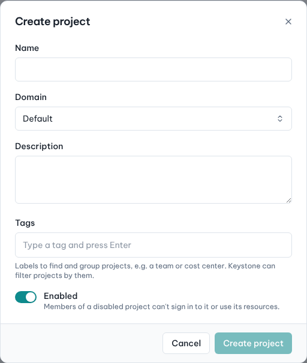
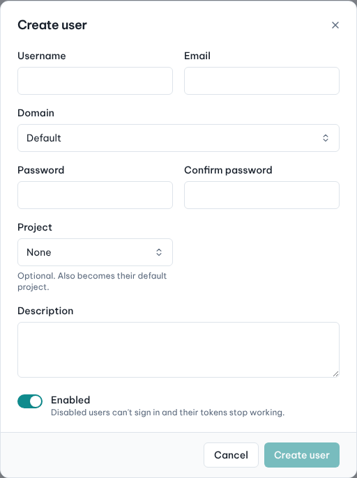
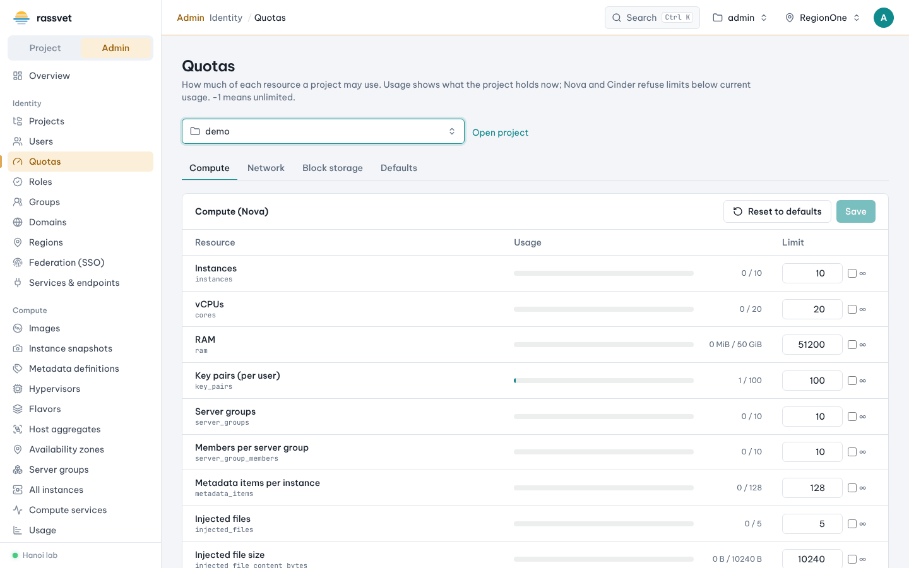

# Projects, users and quotas

## Use case

A new team joins: they need their own project, accounts for their engineers with the right roles, and limits
so they can't use the whole cloud.

## 1. Create the project

1. In the admin view go to **Identity → Projects** and click **Create project**.
2. Enter the **Name**, choose the **Domain**, add a **Description** and optional **Tags** (e.g. a team or cost
   center — Keystone can filter projects by them). Keep **Enabled** on.
3. Click **Create project**.

## 2. Create users

1. Go to **Identity → Users** and click **Create user**.
2. Enter **Username**, **Email**, **Domain** and the **Password** twice.
3. Optionally choose a **Project**: it also becomes the user's default project, and you pick their
   **Role in project** (e.g. `member`). Keep **Enabled** on.
4. Click **Create user**.

## 3. Add members to the project

For existing users, or to give someone several roles:

1. Open the project (**Identity → Projects →** project name).
2. Click **Add member**, find the **User** by name or ID, tick the **Roles** and click **Assign roles**.
3. To change roles later use the member's row menu; with no roles left the user is removed from the project.

Common roles: `reader` (read-only), `member` (normal use), `admin` (cloud administrator — grants the admin view
everywhere, give it sparingly).

## 4. Set quotas

1. Go to **Identity → Quotas** (or the project's row menu **→ Edit quotas**).
2. **Choose a project**.
3. Switch between **Compute**, **Network** and **Block storage**. Each row shows the current **usage** next to the
   limit. Change the limits you need; tick the **∞** box next to a limit to make it unlimited (-1).
4. Click **Save**. Nova and Cinder refuse limits below current usage.

- **Reset to defaults** removes the project's own limits.
- The **Defaults** tab sets the default quotas for every project that has no limits of its own.

## Other identity pages

- **Roles** — create and rename roles.
- **Groups** — manage users in groups and give groups roles on projects.
- **Domains** and **Regions**.
- **Federation (SSO)** — identity providers, protocols and mappings for single sign-on into Keystone.
- **Users → user page** — reset password, enable/disable, project roles and the user's application
  credentials.
