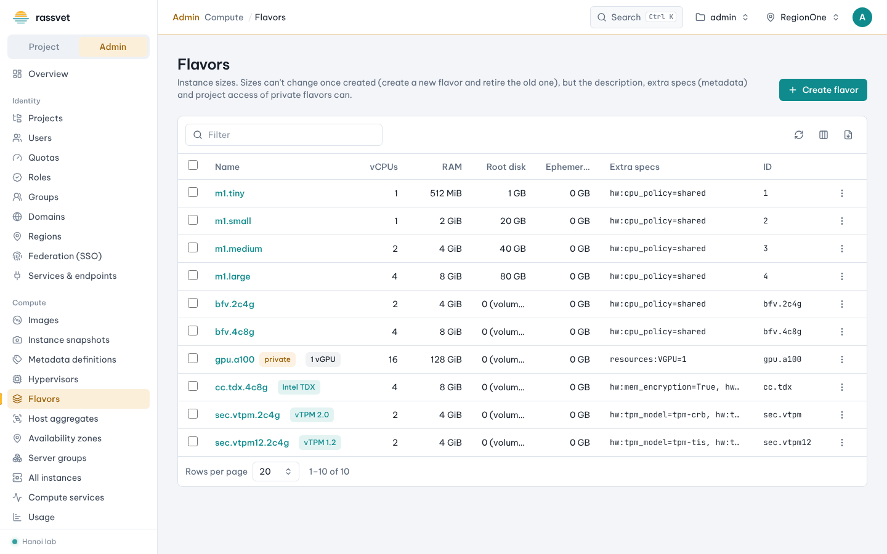
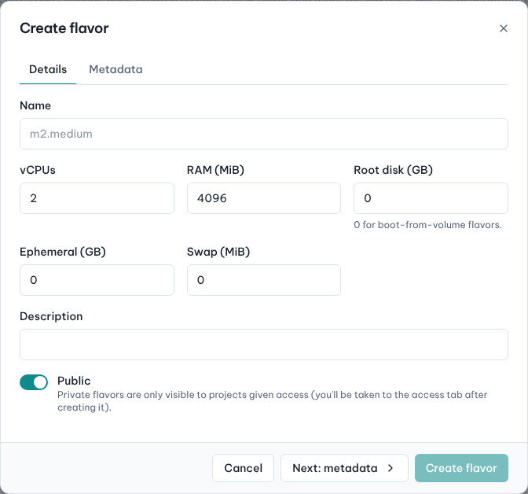
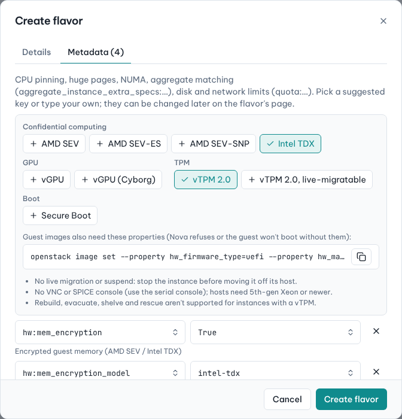

# Flavors

## Use case

Flavors are the instance sizes users pick in the launch wizard. You want to publish general sizes for everyone,
private sizes for one team, and special flavors for confidential computing (AMD SEV / Intel TDX), GPUs or a
virtual TPM — without having to remember Nova's extra-spec keys.

## Create a flavor

1. In the admin view go to **Compute → Flavors** and click **Create flavor**.
2. **Details** tab: enter **Name**, **vCPUs**, **RAM (MiB)** and **Root disk (GB)** (use `0` for
   boot-from-volume flavors — the root disk size then comes from the volume). Optionally **Ephemeral (GB)**,
   **Swap (MiB)** and a **Description**.
3. Keep **Public** on to offer it to every project, or turn it off for a private flavor (you are taken to its
   access tab after creating it).
4. Click **Next: metadata** to add extra specs, or **Create flavor** to finish.

## Add extra specs with presets

The **Metadata** tab offers one-click presets above the key/value editor:

| Group | Presets | What they set |
|-------|---------|---------------|
| Confidential computing | AMD SEV, AMD SEV-ES, AMD SEV-SNP, Intel TDX | `hw:mem_encryption=True` and `hw:mem_encryption_model` |
| GPU | vGPU, vGPU (Cyborg) | `resources:VGPU=1` or `accel:device_profile` |
| TPM | vTPM 2.0, vTPM 2.0 live-migratable | `hw:tpm_version`, `hw:tpm_model` (and `hw:tpm_secret_security=host`) |
| Boot | Secure Boot | `os:secure_boot=required` |

1. Click a preset; its keys are added below. Click it again to remove them. Choosing another preset of the same
   group replaces the first.
2. Read the notes under the presets:
   - the **image properties** the guest image also needs, as a ready `openstack image set …` command (copy it
     and run it for your images);
   - limitations, e.g. *no live migration* for SEV/TDX, or *rebuild, evacuate, shelve and rescue aren't
     supported* with a vTPM;
   - conflicts shown in red, e.g. AMD SEV with a vGPU.
3. Add any other spec with **Add spec** (suggested keys include CPU pinning, huge pages, NUMA, I/O limits) and
   click **Create flavor**.

Users see these flavors with badges (*Intel TDX*, *vTPM 2.0*) in the launch wizard, and Rassvet warns them when
the chosen image doesn't match (for example a vTPM version mismatch).

## Change a flavor later

Open the flavor from the list:

- **Extra specs** — edit, add or delete keys (presets are available here too). New instances pick up the
  changes; running ones keep what they started with until resized.
- **Project access** (private flavors) — **Share with a project**: choose the project and click **Grant**;
  **Revoke access** from the list. Visibility is fixed at creation: to limit a public flavor, create a private copy.
- **Edit description** or **Delete flavor** (running instances keep working; nobody can launch new ones with it).

Nova doesn't allow changing vCPUs, RAM or disk of an existing flavor: create a new flavor and resize the
instances to it.
