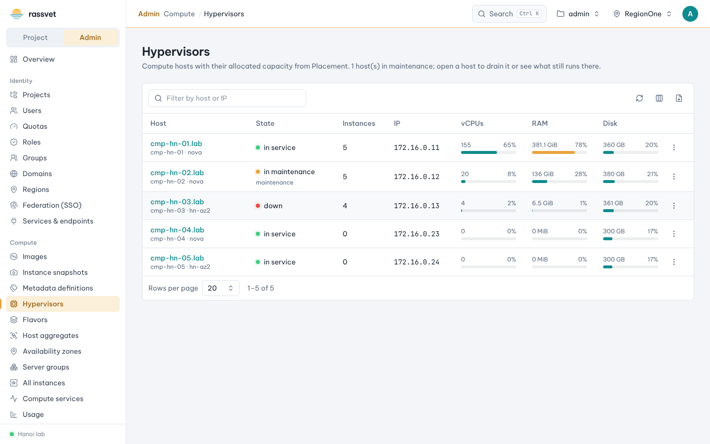
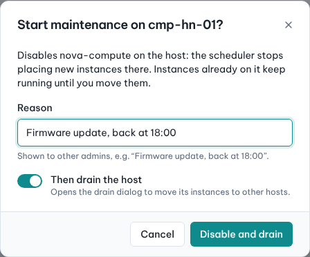
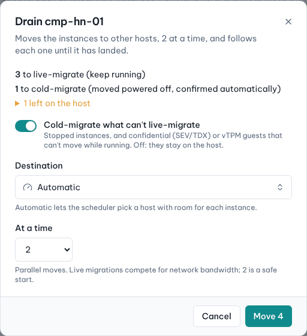
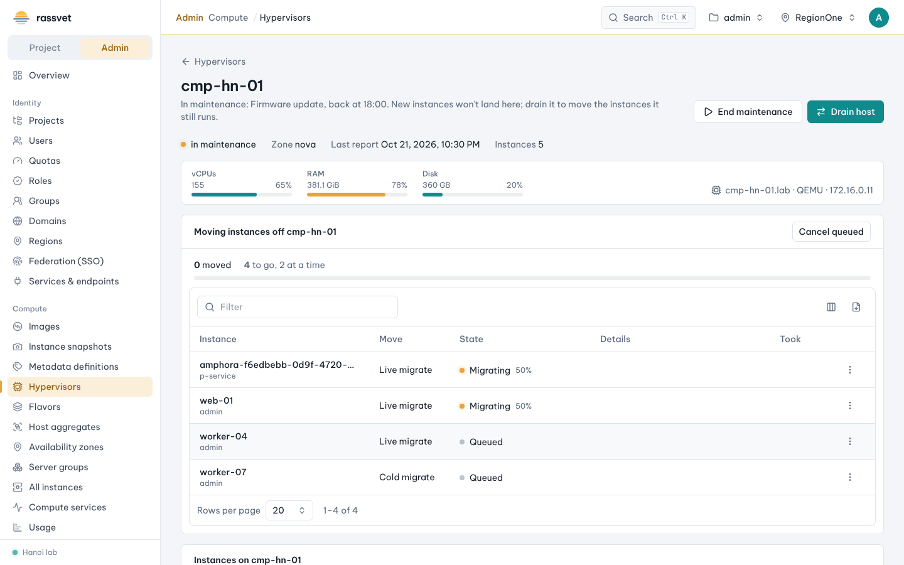

# Hypervisors and host maintenance

## Use case

You need to know how full your compute hosts are, and you regularly take hosts out of service — for a
kernel, firmware or hardware update — without downtime for the instances on them. Sometimes a host dies and
its instances must be restarted elsewhere. All of this is on **Compute → Hypervisors**.

## Read the list

| Column | Meaning |
|--------|---------|
| **Host** | hypervisor name; below it the compute host and availability zone. Click to open the host page. |
| **State** | *in service*, *in maintenance* (with the reason), *down* or *forced down*, plus a progress badge while instances are being moved off |
| **Instances** | how many instances run on the host |
| **vCPUs / RAM / Disk** | allocated vs. capacity from Placement (after allocation ratios); amber above 75%, red above 90% |

The row's **⋮** menu has **Open host** and the maintenance actions below.

## Planned maintenance: drain a host

1. Find the host and choose **⋮ → Start maintenance**.
2. Enter a **Reason** — other admins see it, e.g. "Firmware update, back at 18:00". Keep **Then drain the
   host** on and click **Disable and drain**. The host is disabled: the scheduler stops placing new instances on
   it; running instances are not touched yet.

   

3. The host page opens with the **Drain** dialog. It shows what will happen to each instance:
   - running and paused instances are **live-migrated** (they keep running);
   - stopped instances — and confidential (SEV/TDX) or vTPM instances that can't move while running — are
     **cold-migrated** and the move is confirmed automatically (switch **Cold-migrate what can't live-migrate**
     off to leave them);
   - the rest stays on the host, with the reason (e.g. *In ERROR: reset its state first*, *Shelved: not on a
     host*).
4. Keep **Destination** on *Automatic* (the scheduler picks a host with room) or choose a host, set **At a
   time** (2 parallel moves is a safe start) and click **Move N**.

   

5. Follow the progress card: each instance goes *Queued → Migrating (with % of memory copied) → Moved to
   <host>*. For a live migration that doesn't converge use the row's **Force complete**; **Abort migration**
   stops it. Failed moves show the reason and can be retried with **Retry**. **Cancel queued** stops moves that
   haven't started.

   

6. When **Instances on <host>** is empty (or holds only what you decided to leave), do the maintenance.
7. Back on the Hypervisors list (or the host page) choose **End maintenance**. The host is enabled and the
   scheduler can use it again. Instances that were moved stay where they are.

> Drains run in your browser tab: you can browse other pages meanwhile, but closing or reloading the tab
> stops moves that haven't started (moves already running finish in Nova).

## Move single instances

On the host page, tick instances in **Instances on <host>** and use **Live migrate**, **Cold migrate** or
**Confirm resize** in the bulk bar. Progress shows in the same card.

## Unplanned: evacuate a failed host

When a host is down (or you have fenced it and marked it **forced down** on **Compute → Compute services**),
its instances can be rebuilt on other hosts from their volumes, shared storage or images.

1. Make sure the host is really off. Evacuating a host that is still running makes instances run twice.
2. On **Compute → Hypervisors** choose **⋮ → Evacuate host** for the down host.
3. Check the list, choose **Destination** and **At a time**, and click **Evacuate N**.
4. When the host is repaired and nova-compute runs again, choose **End maintenance** (it also clears *forced
   down*).

## The host page

Open a host from the list to see its capacity bars, hypervisor type and IP, maintenance state and reason, the
moves in progress and every instance on the host with its status and what a drain would do with it.
