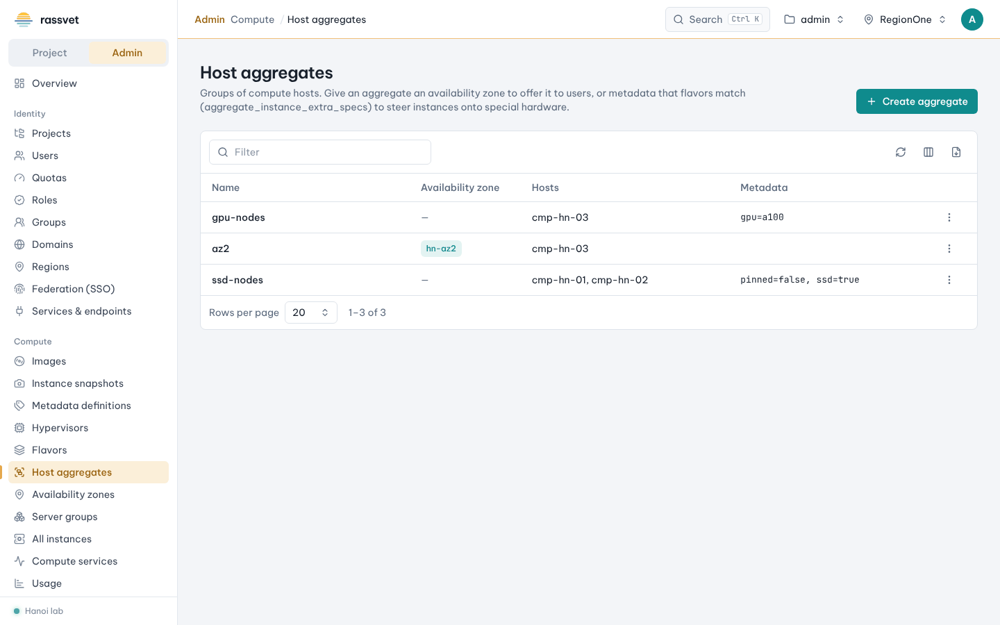
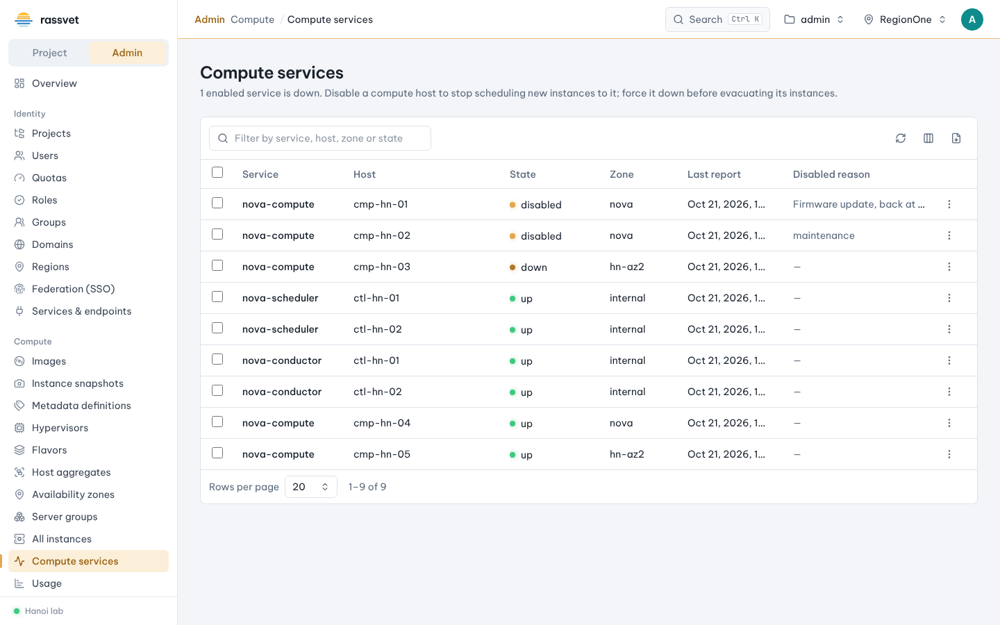

# Aggregates, availability zones and compute services

## Use case

You have different kinds of hosts — GPU nodes, SSD nodes, a second data-center room — and want users to pick a
failure domain (availability zone) or land on special hardware automatically. You also need to switch
individual nova-compute services on and off.

## Publish an availability zone

In Nova, an availability zone is a host aggregate with a zone name.

1. In the admin view go to **Compute → Host aggregates** and click **Create aggregate**.
2. Enter a **Name** (e.g. `dc1-room-b`) and an **Availability zone** (e.g. `az2`). Users see the zone when
   launching.
3. Click **Create**, then choose **⋮ → Manage hosts**, pick the compute hosts and **Save**. A host can be in
   only one zone; Nova refuses a host already in another zone.

**Compute → Availability zones** shows the compute, block storage and network zones with their hosts and
state.

## Steer flavors to special hardware

1. Create an aggregate without a zone, e.g. `gpu-nodes`, and add the GPU hosts.
2. **⋮ → Edit metadata** and add a key, e.g. `gpu=a100`.
3. On the flavor (see [Flavors](03-flavors.md)) add the extra spec
   `aggregate_instance_extra_specs:gpu=a100`. Instances of that flavor now land only on hosts of that aggregate
   (requires the `AggregateInstanceExtraSpecsFilter` in Nova's scheduler).

Other useful aggregate metadata: `filter_tenant_id` (only these projects), `cpu_allocation_ratio`,
`ram_allocation_ratio`, `max_instances_per_host` — suggested in the editor.

## Compute services

**Compute → Compute services** lists every Nova service (nova-compute, nova-scheduler, nova-conductor) with
its host, zone, state and last report.

| Action | When to use it |
|--------|----------------|
| **Disable** (with a reason) / **Enable** | stop or resume scheduling to a host. For planned work prefer **Start maintenance** on [Hypervisors](04-hypervisors-host-maintenance.md), which also drains the host. |
| **Force down** / **Clear forced down** | tell Nova a host is dead without waiting for the heartbeat timeout, so its instances can be evacuated at once. Only when the host is really off. |
| **Delete service** | remove a host that is gone for good (Nova refuses while it still has instances). |

Several services can be enabled or disabled at once with the bulk bar.
