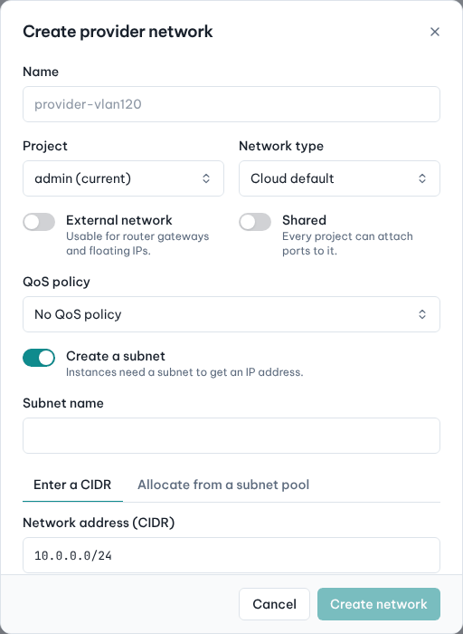
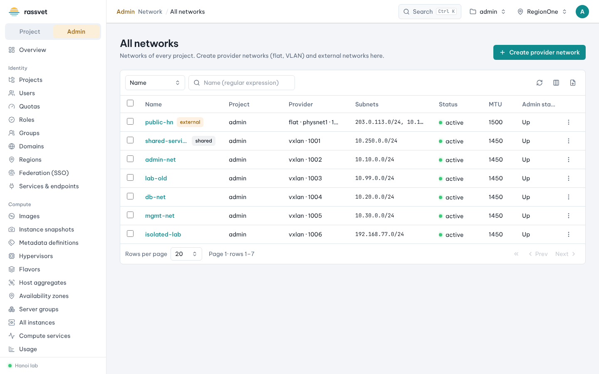

# Provider networks

## Use case

Projects need an external network for router gateways and floating IPs, and perhaps a shared network that
maps straight onto a data-center VLAN. Only admins can create these "provider" networks, because they are tied
to the physical network.

## Create an external network

1. In the admin view go to **Network → All networks** and click **Create provider network**.
2. Enter a **Name** (e.g. `public`) and choose the owning **Project** (usually the admin project).
3. Choose the **Network type** (*flat*, *vlan*, *vxlan*, *geneve*…). For *flat* and *vlan* also enter the
   **Physical network** (from the agents' bridge mappings, e.g. `physnet1`) and, for *vlan*, the **VLAN ID**
   (for overlay types the **Segmentation ID** is optional).
4. Turn on **External network** (usable for router gateways and floating IPs).
5. Keep **Create a subnet** on and enter the public range in **Network address (CIDR)** with its **Gateway**.
   Turn **DHCP** off for external networks.
6. Click **Create network**.

To limit the floating IP range, edit the subnet afterwards (network page → **Subnets**) and set its
**Allocation pools**.

## Create a shared network

Same steps, but turn on **Shared** (every project can attach ports to it) instead of, or in addition to,
**External network**. To share with chosen projects only, leave **Shared** off and use the network's
**Sharing** tab (RBAC) to add projects.

## Related admin pages

- **Network agents** — L3, DHCP, metadata and OVN agents; enable/disable, and move routers or networks between
  agents.
- **IP availability** — used and free addresses per network and subnet; watch the external network.
- **Floating IPs** — allocate an address for any project, optionally a specific one.
- **RBAC policies** and **QoS policies** — of every project.
