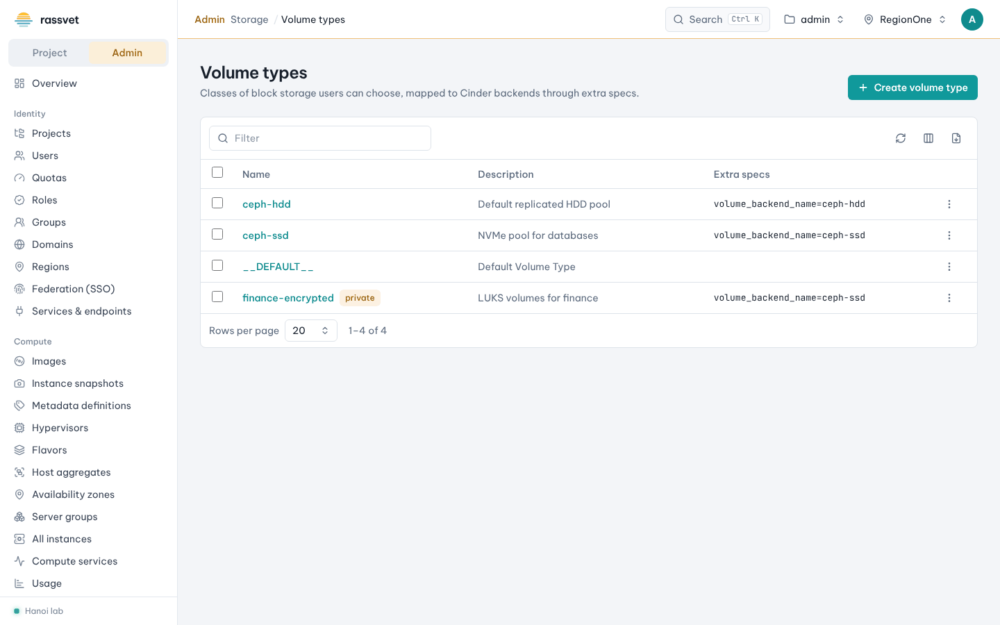

# Volume types and storage

## Use case

Your cloud has more than one kind of block storage — say a Ceph SSD pool and a cheaper HDD pool — and you want
users to choose between them, optionally with IOPS limits or encryption, while you keep an eye on backend
capacity.

## Create a volume type

1. In the admin view go to **Storage → Volume types** and click **Create volume type**.
2. Enter a **Name** (e.g. `ssd`) and a **Description** users will understand.
3. In **Backend name** enter the Cinder backend's `volume_backend_name` (e.g. `ceph-ssd`) so volumes of this
   type land on that backend.
4. Keep **Public** on to offer it to every project (or turn it off and grant projects access later).
5. Click **Create**.

Open the type (**Manage**) to:

- edit **Extra specs** (suggested keys such as `volume_backend_name`, `multiattach`, replication…),
- give private types **Project access**,
- associate a **QoS** spec (front-end limits such as `total_iops_sec`, or back-end limits) — create QoS specs
  under **Storage → QoS specs**,
- configure **Encryption** (LUKS with keys in Barbican).

Users see the type in the **Type** list when they create a volume, and in the launch wizard's root volume
options. Cinder refuses to delete a type that volumes still use, and the cloud's default type can't be deleted.

## Watch backend capacity

**Storage → Storage backends** shows every Cinder service (volume, scheduler, backup) with its state, and for
each pool the **Pool usage**: provisioned and free capacity, reserved space and over-subscription for thin
provisioning.

To take a backend out of service for maintenance, choose **Disable service**, enter a **Reason** (shown to
other admins, e.g. "Ceph pool maintenance until 18:00") and confirm: Cinder stops sending new volumes to it,
existing volumes keep working. **Enable service** puts it back.

## Volumes of every project

**Storage → All volumes** and **All backups** list everything across projects with a **Project** column. Extra
admin actions: **Reset status** (for volumes stuck in a transitional state), **Migrate volume** to another
backend, and force delete.
