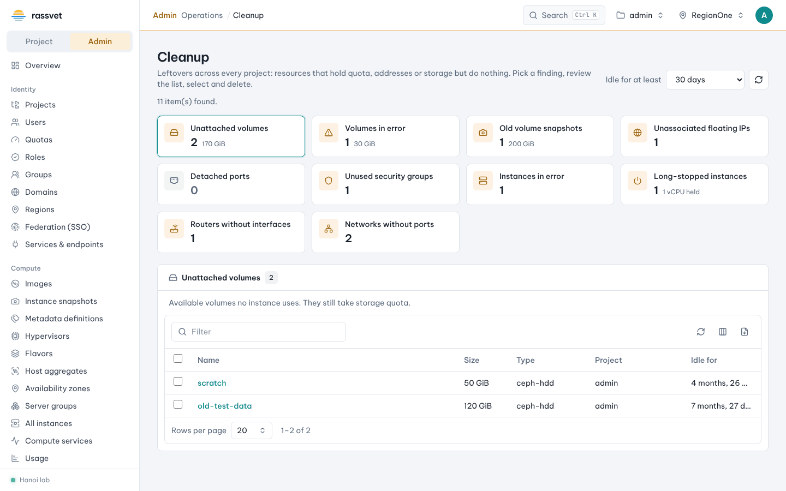

# Cleanup across projects

## Use case

The cloud is running out of capacity or public addresses, and you suspect projects hold resources they no
longer use. **Operations → Cleanup** in the admin view runs the same checks as the
[project Cleanup](../project/13-cleanup.md), but across **every project**, with a **Project** column so you can
contact the owners or clean up yourself.

## Steps

1. Switch to the admin view and go to **Operations → Cleanup**.
2. Choose **Idle for at least** (Any age … 365 days; default 30).
3. Click a finding card — unattached volumes, volumes in error, old snapshots, unassociated floating IPs,
   detached ports, unused security groups, instances in error, long-stopped instances, routers without
   interfaces, networks without ports.
4. Sort or filter the list by **Project**, export it with the CSV button to send to project owners, or tick
   items and use the bulk action.
5. Admin extra: for **Volumes in error** a **Force delete** bulk action is available when a normal delete is
   refused.

## Good practice

- Ask owners first: export the list as CSV and give them a deadline.
- Prefer **Shelve** for long-stopped instances — it frees the host but keeps the instance.
- Release unused floating IPs of the external network to keep addresses available for everyone.
- Run it after every [host maintenance](04-hypervisors-host-maintenance.md) cycle to catch instances left in
  ERROR.
