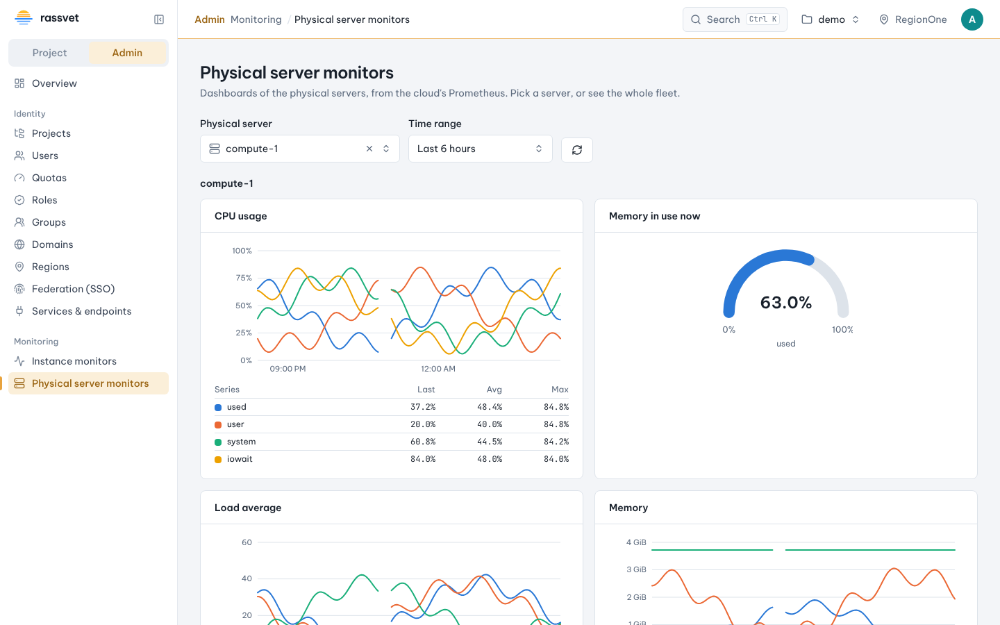

# Monitoring (instances and physical servers)

## Use case

You want project users to see how their instances are doing, and you want charts of your physical servers
in the same dashboard. The **Monitors** extension reads metrics that Telegraf writes to Prometheus. Project
users get **Monitoring → Instance monitors** for their own project. Admins also get
**Instance monitors** for every project and **Physical server monitors** in the admin view.



## Who sees what

| | Project user | Admin (`admin` role) |
|---|---|---|
| Instances | Only their token's project (`project_id` label) | Any project, or every project at once |
| Project totals | Their project | Any project |
| Physical servers | No | Yes |
| How far back | 60 days (`project_max_range_days`) | 1 year (`admin_max_range_days`) |

Rassvet enforces these rules on the server. The browser never sends PromQL: it picks a chart by name, and
Rassvet builds the query and adds `project_id="<project of the token>"` for project users. A project user
who asks for another project's instance gets no data. Requests for physical servers or for older data are
refused.

## Metrics and labels

Rassvet expects these labels, written by Telegraf:

| Label | Value |
|-------|-------|
| `monitor` | Starts with `cloud` for instance metrics (e.g. `cloud`, `cloud-infras`), with `physical` for physical server metrics. Change the patterns with `cloud_monitor` / `physical_monitor` |
| `project_id`, `project_name` | The instance's Keystone project |
| `guest_id`, `guest_name` | The Nova instance UUID and name |
| `region` | The Keystone region name |
| `compute_node_id`, `hostname` | The compute node UUID and name (physical servers) |

It reads these metrics, named the way Telegraf's `outputs.prometheus_client` names them
(`<measurement>_<field>`):

- **Instances** (`monitor=~"cloud.*"`): the libvirt exec script. `libvirt_cpu_time` (ns),
  `libvirt_cpu_number`, `libvirt_memory_used`, `libvirt_memory_resident`, `libvirt_memory_total` (KiB),
  `libvirt_memory_used_percent`, `libvirt_disk_*` (`read_bytes`, `write_bytes`, `read_requests`,
  `write_requests`, `rd_total_times`, `wr_total_times`, `allocation`, `capacity`, by `device`) and
  `libvirt_net_*` (`read_bytes`, `write_bytes`, `read_packets`, `write_packets`, `read_errors`,
  `write_errors`, `read_drops`, `write_drops`, by `device`). The instance and project lists come from
  `libvirt_cpu_time` and `libvirt_memory_total`.
- **Physical servers** (`monitor=~"physical.*"`): Telegraf's `cpu` (`cpu_usage_*` with `cpu="cpu-total"`),
  `system` (`system_load1/5/15`), `mem` (`mem_used`, `mem_available`, `mem_total`, `mem_used_percent`),
  `disk` (`disk_used_percent` by `path`), `diskio` (`diskio_read_bytes`, `diskio_write_bytes` by `name`)
  and `net` (`net_bytes_recv`, `net_bytes_sent` by `interface`) inputs. Instance and virtual network
  interfaces (`tap*`, `qvo*`, `qbr*`, `vnet*`, `br-*`, `vxlan*`…) are left out of the network chart. The
  server list comes from `cpu_usage_idle{cpu="cpu-total"}`.
- **Nova's view** (from the OpenStack database exec script):
  `openstack_compute_node_usage_{vcpus_used,vcpus_total,memory_mb_used,memory_mb_total,running_vms}`,
  matched by `compute_node_id` only, and
  `openstack_project_usage_total_{instances,vcpus,memory_mb,volume_gb,snapshot_gb,networks,ports,routers}`,
  matched by `project_id`.

## Telegraf

On each compute node, run the libvirt script for instance metrics and Telegraf's own inputs for the
server. Tag them with `monitor`, and give the physical inputs the node's `compute_node_id` and `hostname`
(`openstack hypervisor show <host> -c id -c hypervisor_hostname`):

```toml
[global_tags]
  region = "RegionOne"

[[inputs.exec]]
  commands = ["/usr/bin/python3 /opt/telegraf/libvirt_telegraf.py"]
  timeout = "30s"
  data_format = "influx"
  [inputs.exec.tags]
    monitor = "cloud"

[[inputs.cpu]]
  percpu = false
  totalcpu = true
  [inputs.cpu.tags]
    monitor = "physical"
    compute_node_id = "6f2c4d0e-7f1b-4a8e-9b0c-2d3e4f5a6b7c"
    hostname = "compute-1"
# Same tags on [[inputs.mem]], [[inputs.system]], [[inputs.disk]], [[inputs.diskio]] and [[inputs.net]].

[[outputs.prometheus_client]]
  listen = ":9273"
```

Run the OpenStack database script on one controller (`inputs.exec` with `data_format = "influx"`), and have
Prometheus scrape every Telegraf, or send to Prometheus with remote write.

## Connect Rassvet

Add a `[cloud.extensions.monitors]` table under the cloud's `[[cloud]]` block in `rassvet.toml` and restart
Rassvet. Clouds without the table don't show the Monitoring menu.

```toml
[[cloud]]
id = "lab"
# ...

[cloud.extensions.monitors]
prometheus_url = "http://prometheus.example.com:9090"  # any Prometheus-compatible query API
# bearer_token_file = "/etc/rassvet/prometheus.token"   # or bearer_token, or username + password(_file)
# ca_file = "/etc/ssl/certs/prometheus-ca.pem"
project_max_range_days = 60
admin_max_range_days = 365
# timeout_seconds = 30
# rate_window_seconds = 300   # smallest rate() window: at least 4 × the Telegraf interval
# region_filter = false       # also match region="<session region>" when one Prometheus serves several regions
# cloud_monitor = "cloud.*"           # regex for the monitor label of instance metrics (whole value)
# physical_monitor = "physical.*"     # regex for the monitor label of physical server metrics
```

For VictoriaMetrics, use the address of its Prometheus query API: `http://victoriametrics:8428` for a
single node, or `http://vmselect:8481/select/<tenant>/prometheus` for a cluster.

Prometheus is only called by the Rassvet server, so it doesn't have to be reachable from users' browsers.

## Use it

- **Instance monitors** (admin view): pick a **Project** (or *All projects*), then an **Instance**. Without
  an instance you see the project's totals.
- **Physical server monitors**: pick a server by host name. Next to CPU, load, memory, disks and network,
  the page shows Nova's view of the node: vCPUs and memory used against what it offers, and running
  instances.

Both pages offer time ranges up to a year and a custom from / to.
