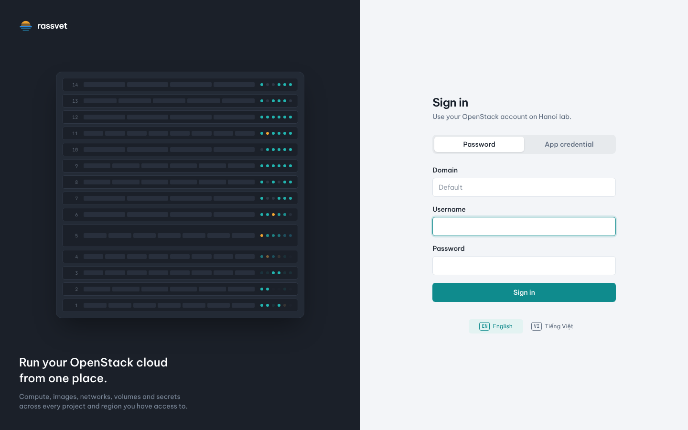
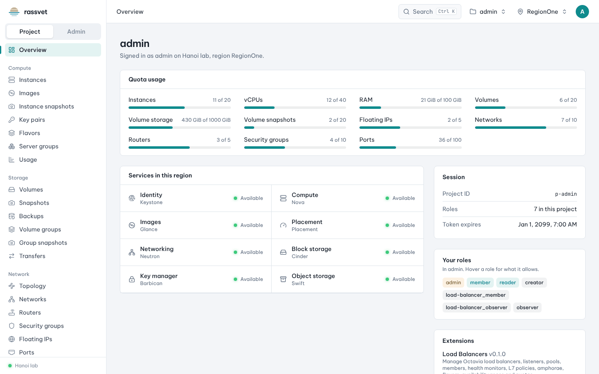
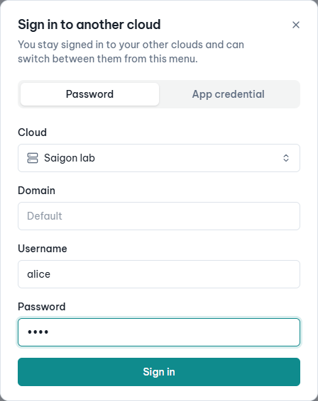
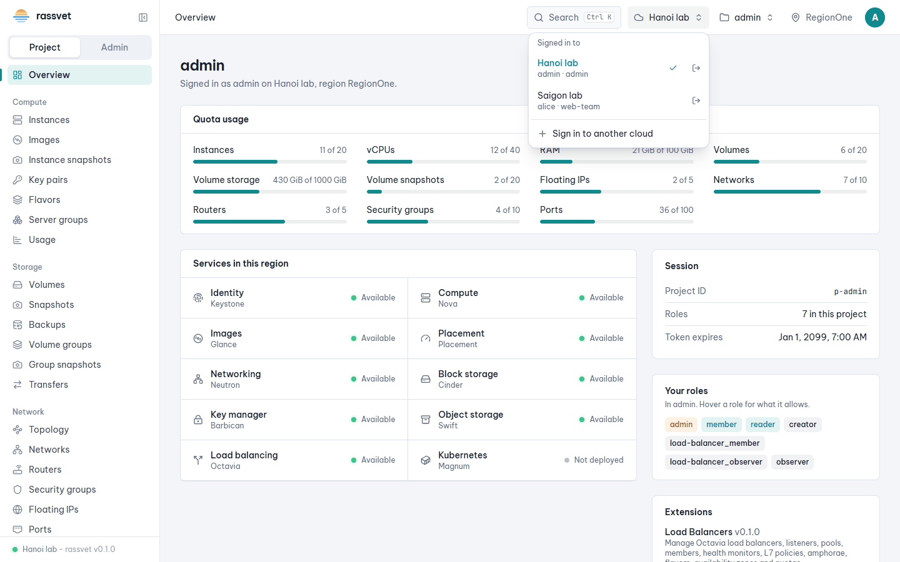
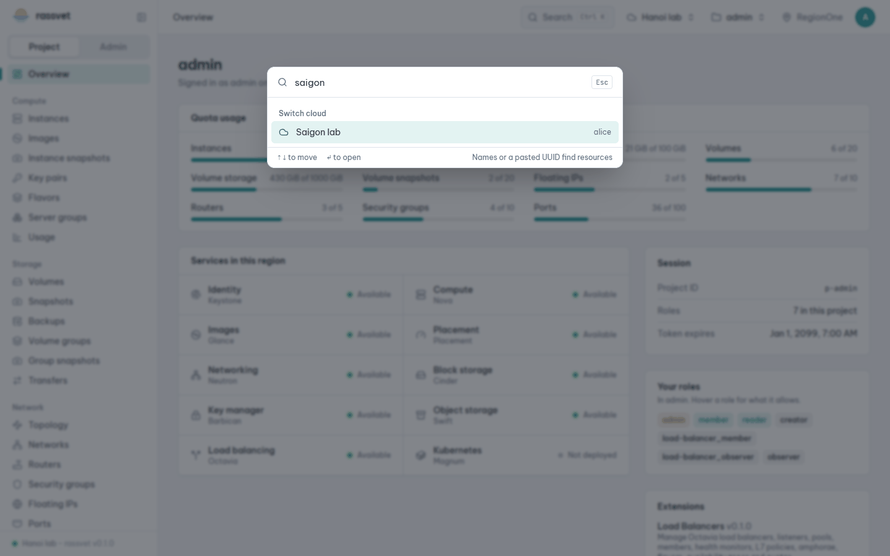
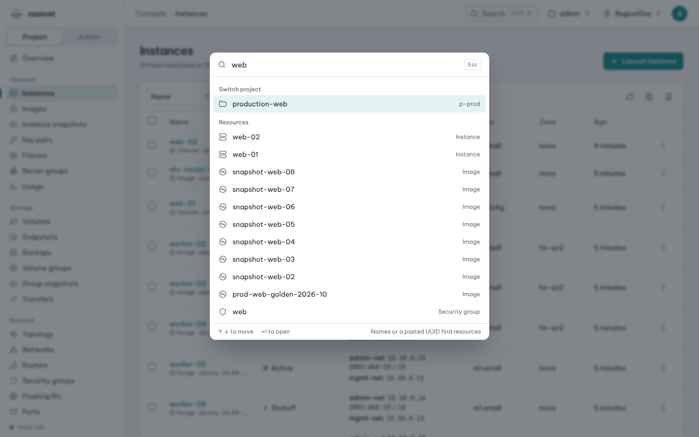

# Getting started

## Use case

You have an OpenStack account and want to start working in your project: see what you have, how much quota
is left, and find any page or resource quickly.

## Sign in

1. Open Rassvet in your browser (your operator gives you the address, e.g. `https://cloud.example.com`).
2. If your operator configured several clouds, pick one in **Cloud**.
3. Choose how to sign in:
   - **Password** — enter **Domain** (usually `Default`), **Username** and **Password**.
   - **App credential** — enter the **Credential ID** and **Secret** of an application credential
     (see [API access](12-api-access.md)); you land directly in the project it is bound to.
4. Click **Sign in**.

Your session ends after a period of inactivity (one hour by default) or when you click **Sign out** in the
account menu (which signs you out of every cloud).

## Find your way around

- **Left menu** — pages grouped by service: *Compute*, *Storage*, *Network*, *Object storage*, *Key manager*,
  *Identity* and *Operations*. Entries appear only for services your cloud offers.
- **Overview** — quota usage of the project (instances, vCPUs, RAM, volumes, floating IPs, networks…) and the
  services available in the current region.
- **Top bar** — from left to right: where you are, **Search** (command palette), the **cloud** switcher (when
  your operator configured several clouds), the **project** switcher, the **region** switcher and your
  **account** menu.
- **Project / Admin** — users with the `admin` role see a switch at the top of the menu; see the
  [admin guides](../admin/01-admin-view.md).
- **Cloud and version** — the bottom of the left menu shows the cloud you are signed in to and the Rassvet
  version, e.g. *Hanoi lab - rassvet v0.1.0* (also shown under the sign-in form). Mention it when you report a
  problem.

## Collapse the left menu

On wide screens, click **Collapse menu** (panel icon next to the *rassvet* logo) to shrink the menu to a narrow
column of icons and give the page more width — handy for wide tables and the topology. Hover an icon to see the
page's name; the logo, the Project / Admin switch and the cloud status stay available as icons too (hover the
status dot for the cloud name and version). Click **Expand menu** (panel icon under the logo) to bring the
labels back. Rassvet remembers your choice in this browser. You can also press **Ctrl K** and run
**Collapse or expand the menu**. On narrow screens the menu is a drawer opened with the ☰ button.

## Work with several clouds

When your operator configured several clouds, you can stay signed in to all of them and switch without
signing out:

1. Click the cloud name in the top bar (cloud icon) and choose **Sign in to another cloud**.
2. Pick the cloud, enter its credentials (each cloud has its own accounts) and click **Sign in**. You land in
   the new cloud and stay signed in to the others.

   

3. To switch, click the cloud name and pick another cloud from **Signed in to**: no password needed. Each
   cloud shows the user and project you use there.

   

   You can also press **Ctrl K** and type the cloud's name:

   

4. To leave one cloud only, click the sign-out icon next to it. **Sign out** in the account menu leaves all.

Each browser tab remembers its own cloud, so you can keep one tab on each cloud side by side. A new tab opens
on the cloud you switched to last. When a cloud's sign-in expires, the tabs on it move to another cloud you
are still signed in to.

## Switch project or region

1. Click the project name in the top bar (folder icon) and pick another project. Type to filter when you have
   many.
2. Click the region name (pin icon) to switch region. Every page reloads its data for the new project or
   region.

## Use the command palette

The fastest way to go anywhere.

1. Press **Ctrl K** (**⌘ K** on macOS) or click **Search** in the top bar.
2. Type a few letters:
   - a page name (`volumes`, `routers`) to open it,
   - an action (`launch`, `create network`, `allocate floating ip`, `dark theme`, `sign out`),
   - a resource name (`web-01`), an IP address or a CIDR, or paste a resource UUID, to open it. Every kind of
     resource is searched: instances, images, flavors, key pairs, server groups, volumes, volume snapshots,
     backups and groups, networks, subnets, ports, routers, security groups, floating IPs, trunks, QoS
     policies, subnet pools, secrets, secret containers, orders and object containers — plus projects, users,
     groups and volume types in the admin view, and load balancers, DNS zones and Kubernetes clusters when the
     cloud has those services. A resource without a page of its own (a snapshot, a port…) opens its list,
     filtered to it.
   - `<type>:<name>` to search one kind only: `ins:web`, `in:web` or `instances:web` finds instances named
     like *web*, `vol:pfsense` or `volume:pfsense` volumes, `snap:`, `sg:`, `net:`, `fip:`, `lb:`, `zone:`…
     The type can be cut short (`vol`, `inst`) or plural; with nothing after the colon it lists that kind,
     and a pasted UUID after it looks up only that kind.
3. Use **↑ ↓** to move and **Enter** to open. **Esc** closes the palette.

## Work with lists

Every list (instances, volumes, ports…) works the same way:

- **Filter** — type in the filter box; large lists also offer a field picker to search on the server
  (name, status, IP, flavor, ID…).
- **Sort** — click a column header.
- **Rows per page**, **column chooser** and **CSV export** — at the bottom and top right of the table.
- **⋮ menu** at the end of a row — every action for that resource.
- **Bulk actions** — tick several rows (shift-click selects a range), then pick an action in the bar that
  appears. Rassvet shows which rows will be skipped and why, and reports the result of each row.

Tables remember their filter and sort until you sign out.

## Personal settings

Open the account menu (your initial, top right):

- **Light / Dark / System** theme.
- **Language** — English or Tiếng Việt.
- **My profile** and **Change password** (changing the password signs you out everywhere).
- **Sign out**.

## Next

- [Launch your first instance](02-launch-instance.md)
