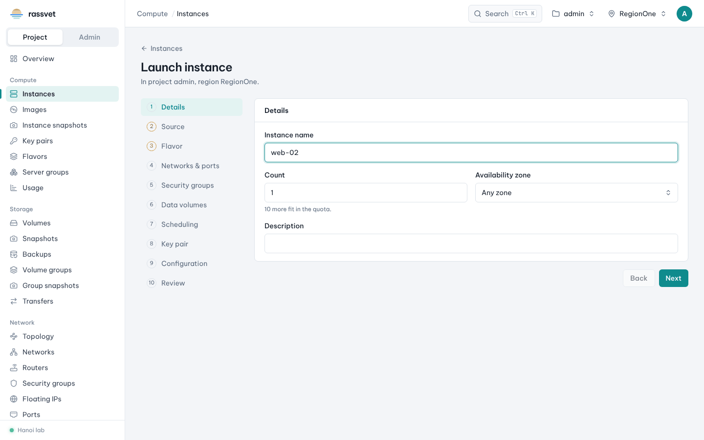
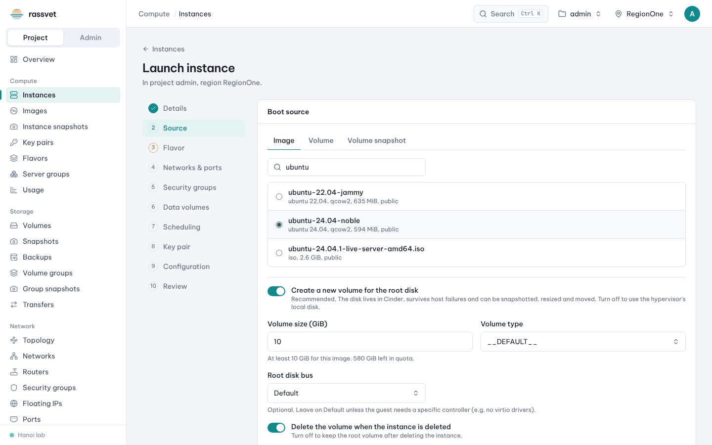
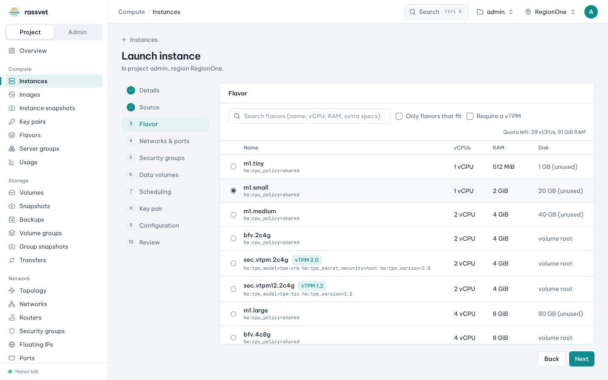
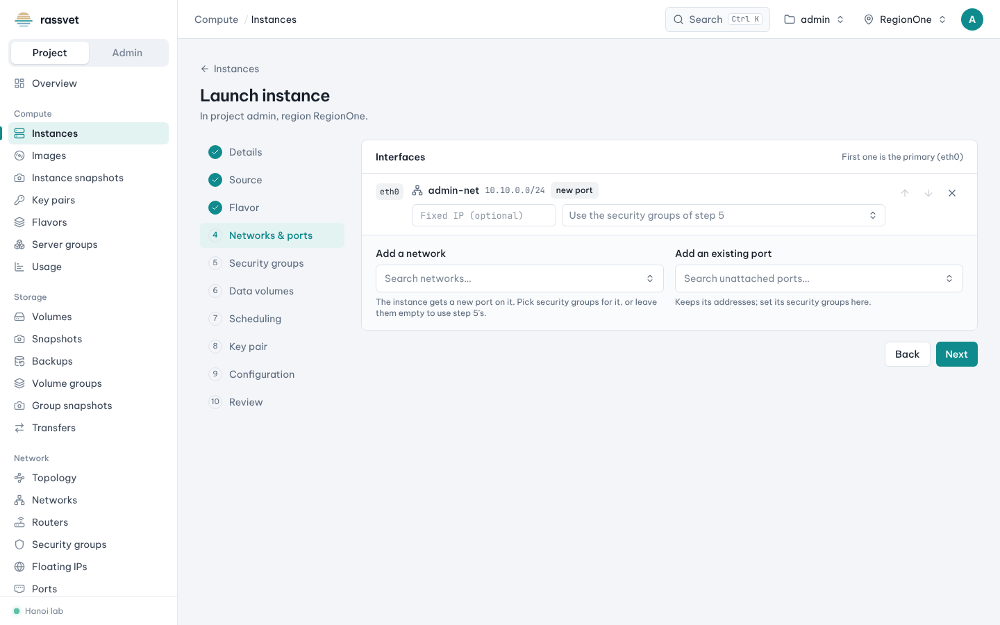
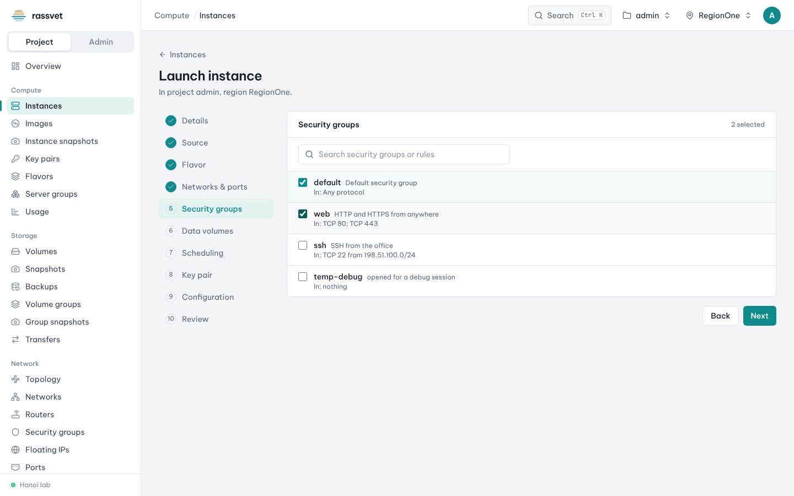
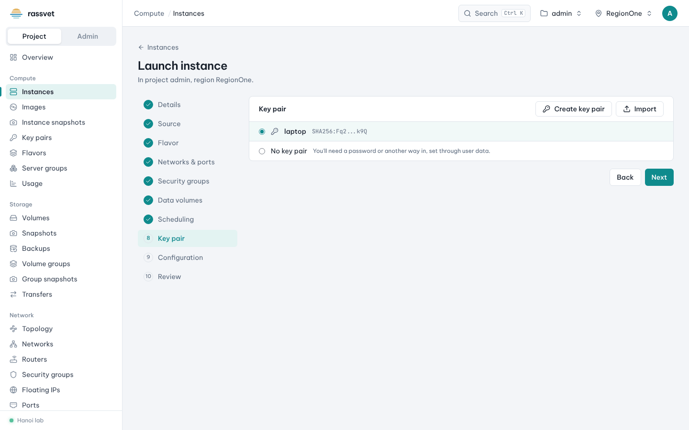
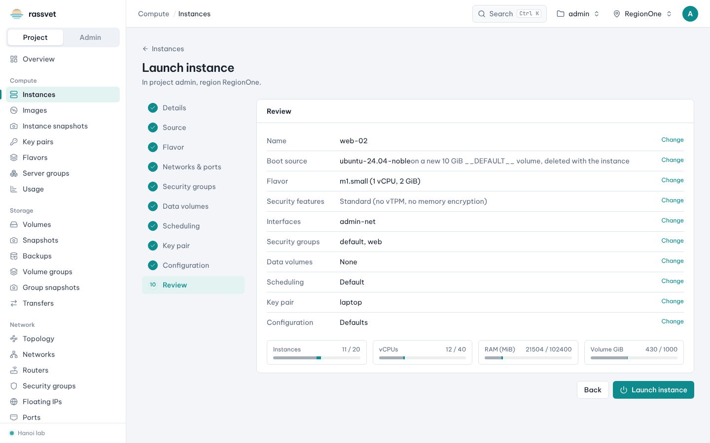
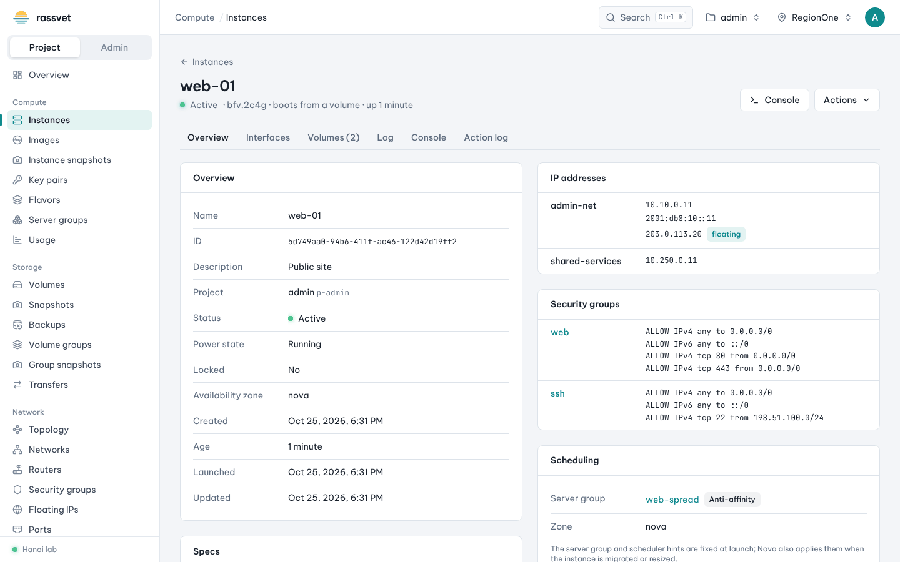

# Launch an instance

## Use case

You need a virtual machine — for example an Ubuntu web server reachable over SSH — in your project.
The launch wizard walks you through every choice and shows the quota impact before anything is created.

## Before you start

- A **network** with a subnet in your project (or a shared one). See [Networks and routers](06-networks-and-routers.md).
- A **key pair** to log in over SSH. You can create one inside the wizard; see also [Key pairs](04-key-pairs.md).
- A **security group** that allows the traffic you need (e.g. SSH). See [Security groups](07-security-groups.md).

## Steps

1. Go to **Compute → Instances** and click **Launch instance** (or press **Ctrl K** and type `launch`).
   The wizard has ten steps on the left; a check mark shows the steps that are complete, and you can jump to any
   step at any time.

2. **Details** — enter the **Instance name**. Optionally set **Count** (several identical instances; the hint
   tells you how many fit in the quota), an **Availability zone** and a **Description**.

   

3. **Source** — choose what the instance boots from:
   - **Image** (most common): search, e.g. `ubuntu`, and select the image.
   - **Volume** or **Volume snapshot**: boot from existing block storage.

   By default **Create a new volume for the root disk** is on: the root disk lives in Cinder, survives host
   failures and can be snapshotted, resized and moved. Set **Volume size (GiB)** (at least the image's minimum),
   **Volume type**, and whether to **Delete the volume when the instance is deleted**. Turn the switch off to use
   the hypervisor's local disk instead.

   

4. **Flavor** — pick the size (vCPUs, RAM, disk). **Only flavors that fit** hides flavors your image or quota
   can't use. Flavors with special features show badges such as *vTPM 2.0* or *Intel TDX*; tick
   **Require a vTPM** if your guest needs one (e.g. Windows 11 with BitLocker).

   

5. **Networks & ports** — the first interface is the primary one (`eth0`). Use **Add a network** to give the
   instance a new port on a network (optionally with a fixed IP or its own security groups), or
   **Add an existing port**. Use the up / down arrows on an interface to change the order.

   

6. **Security groups** — tick the groups to apply to the instance's new ports, e.g. `default` and `web`.
   The rules of each group are listed under its name.

   

7. **Data volumes** (optional) — add a **New blank volume**, a volume **From image (ISO…)** or
   **Attach an existing volume**. They are attached after the root disk, in order.

8. **Scheduling** (optional) — put the instance in a **Server group** (affinity / anti-affinity), keep it away
   from or together with other instances, or add custom scheduler hints.

9. **Key pair** — select the key pair to inject, or click **Create key pair** / **Import** right here.
   With **No key pair** you need another way in, such as a password set through user data.

   

10. **Configuration** (optional) — paste **User data** (a cloud-init script or `#cloud-config` document; use
    **Load from a file** for long ones), turn on **Use a config drive**, and add instance **Metadata**.

    Example user data that installs nginx on first boot:

    ```yaml
    #cloud-config
    package_update: true
    packages:
      - nginx
    ```

11. **Review** — check every choice (click **Change** to go back to a step) and the quota bars at the bottom,
    then click **Launch instance**.

    

## Result

Rassvet opens the new instance. Its status goes from *Spawning* to *Active* within a minute or two; the
**Overview** tab shows its IP addresses, security groups with their rules, and scheduling details.



## Next steps

- Give it a public address: [Associate a floating IP](03-manage-instances.md#give-the-instance-a-public-ip).
- Log in: `ssh -i laptop.pem ubuntu@<floating IP>` (the user name depends on the image: `ubuntu`, `debian`,
  `cloud-user`, `rocky`…).

## Troubleshooting

- **Launch instance stays disabled** — the step marked in amber is missing something (e.g. no flavor chosen).
- **Status ERROR** — open the instance; the **Overview** shows the fault message (for example *No valid host
  was found*: no hypervisor has room for the flavor, ask your operator).
