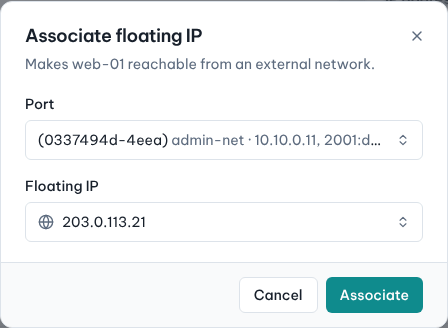
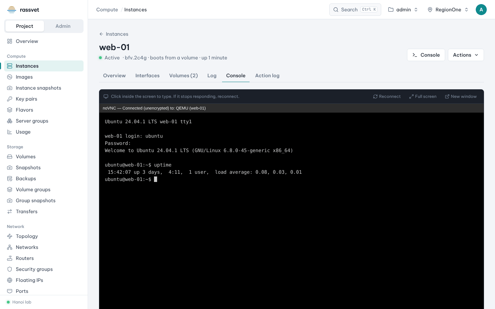

# Work with instances

## Use case

Your instance is running and you need to operate it day to day: reach it from the internet, look at its
screen, add storage, take a snapshot before an upgrade, give it more CPU and RAM, or switch it off.

Every action is in two places: the **⋮** menu at the end of the instance's row in **Compute → Instances**, and
the **Actions** button on the instance's page. Actions that don't apply to the current state are greyed out
with the reason on hover.

The instance page has these tabs:

| Tab | What you see |
|-----|--------------|
| **Overview** | name, status, flavor, image or boot volume, IP addresses, security groups and their rules, metadata, fault details on errors |
| **Interfaces** | ports with their IPs, security groups and floating IPs; attach, detach and edit ports |
| **Volumes** | attached volumes and device names |
| **Log** | the boot console log |
| **Console** | the instance's screen (noVNC) right in the page |
| **Action log** | who did what and when (start, stop, resize…) |

## Give the instance a public IP

1. Open the instance and choose **Actions → Associate floating IP**.
2. Pick the **Port** (the instance's interface) and a **Floating IP** — an existing free address, or
   **Allocate a new floating IP**.
3. Click **Associate**. The address appears under **IP addresses** on the Overview.

The network of the port must be connected to a router with an external gateway; see
[Networks and routers](06-networks-and-routers.md). To remove it later: **Actions → Disassociate floating IP**.

## Open the console

1. Open the instance and click **Console** (top right) or the **Console** tab.
2. Click inside the screen to type. Use **Full screen** or **New window** for more room, and **Reconnect**
   if it stops responding.

## Attach a volume

1. **Actions → Attach volume**.
2. Choose the **Volume**; optionally turn on **Delete the volume with the instance**.
3. Click **Attach volume**. Inside the guest the disk appears as the next device (e.g. `/dev/vdb`); format and
   mount it the first time.

Detach with **Actions → Detach volume** (unmount it in the guest first).

## Take a snapshot

1. **Actions → Create snapshot**, enter a **Snapshot name**, click **Create snapshot**.
2. For a volume-backed instance the root volume is snapshotted in Cinder and an image pointing at it is
   created in Glance. The snapshot appears in **Compute → Instance snapshots**; launch new instances from it like
   from any image.

## Resize (change the flavor)

1. **Actions → Resize**, choose the **New flavor**, click **Resize**.
2. The instance restarts on the new size and its status becomes *Verify resize*.
3. Check the instance, then choose **Actions → Confirm resize** (or **Revert resize** to go back).

## Change security groups

**Actions → Edit security groups** to add or remove groups on the instance's ports. Changes apply immediately;
no restart is needed.

## Power and lifecycle

| Action | What it does |
|--------|--------------|
| **Stop** / **Start** | Shuts the guest down / boots it again. A stopped instance still holds its vCPUs and RAM on the host. |
| **Soft reboot** / **Hard reboot** | Graceful restart through the guest / power cycle. |
| **Pause** / **Suspend** | Freeze in memory / save to disk. |
| **Shelve** | Snapshot and remove from the host to free resources; **Unshelve** brings it back. |
| **Lock** | Prevents changes and deletion until unlocked. |
| **Rebuild** | Reinstall from an image, keeping the IPs. |
| **Rescue** | Boot a rescue image with the instance's disk attached, to repair it. |
| **Delete instance** | Deletes it. Its root volume goes too when it was created with "delete with the instance". |

Several instances at once: tick them in the list and use the bulk bar (**Start**, **Stop**, **Reboot**, **Delete**).

## Edit name, tags and metadata

- **Edit instance** — name and description.
- **Edit tags** — free-form labels you can filter the list by.
- **Edit metadata** — key/value pairs, with suggestions from the cloud's metadata definitions.
