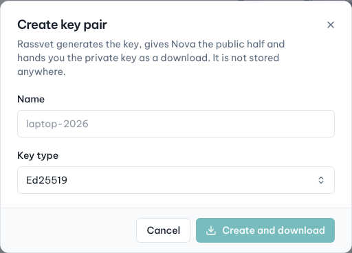

# Key pairs

## Use case

Linux cloud images don't have passwords: you log in with an SSH key that Nova injects at launch. You either
let Rassvet generate a key pair for you, or import the public key you already use.

## Create a key pair

1. Go to **Compute → Key pairs** and click **Create key pair**.
2. Enter a **Name** (letters, digits, spaces and `. _ - @`) and choose the **Key type** (*Ed25519* is the
   default and recommended; RSA for old systems).
3. Click **Create and download**. Your browser downloads `<name>.pem`. You can also **Copy private key**.



> The private key is shown only once. Rassvet gives Nova the public half and does not store the private key
> anywhere — keep the file safe.

On Linux or macOS, protect the file before using it:

```sh
chmod 600 ~/Downloads/laptop.pem
```

## Import an existing public key

1. Click **Import public key**.
2. Enter a **Name** and paste your **Public key** (the content of `~/.ssh/id_ed25519.pub`, starting with
   `ssh-ed25519` or `ssh-rsa`).
3. Click **Import key pair**.

## Use the key

- Choose it in the **Key pair** step when you [launch an instance](02-launch-instance.md). You can also create
  or import one right there.
- Log in with the matching private key:

  ```sh
  ssh -i ~/Downloads/laptop.pem ubuntu@203.0.113.21
  ```

Key pairs belong to your user, not to the project. Deleting a key pair doesn't change instances that were
launched with it.
