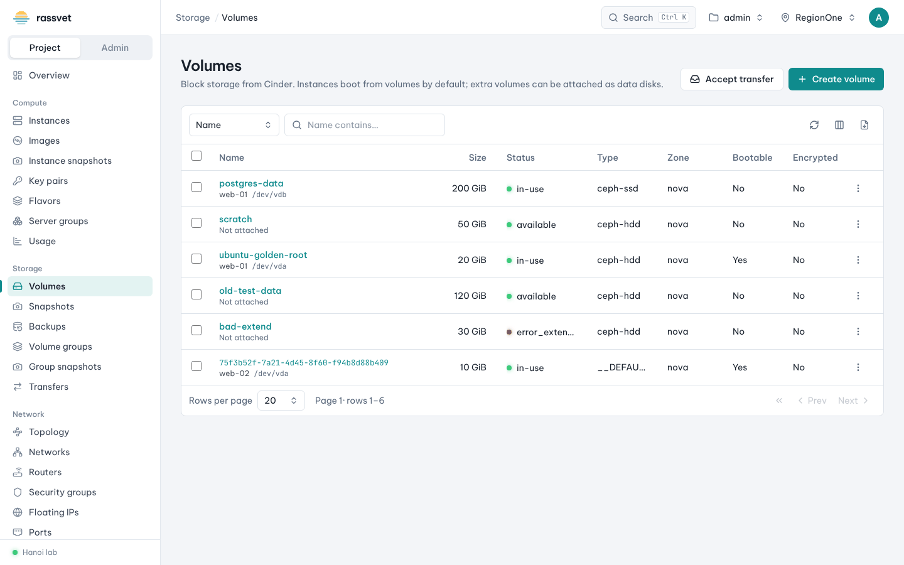
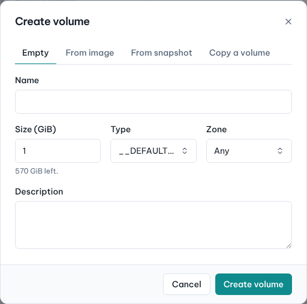
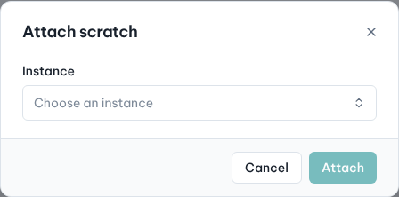

# Volumes

## Use case

Your application needs persistent disk space that outlives any single instance — a database data disk, a
shared scratch area, or a disk you can snapshot and back up. Volumes (Cinder) are block devices you attach to
instances and move between them.



The list shows each volume's size, status, type and where it is attached (for example
`/dev/vdb on web-01`). Every action is in the row's **⋮** menu and on the volume's page.

## Create a volume

1. Go to **Storage → Volumes** and click **Create volume**.
2. Choose the source: **Empty**, **From image**, **From snapshot** or **Copy a volume**.
3. Enter a **Name** and **Size (GiB)** (the hint shows what's left in the quota), pick a **Type** (storage
   tier, e.g. SSD) and optionally a **Zone** and **Description**.
4. Click **Create volume**. The status goes from *creating* to *available*.



## Attach it to an instance

1. In the volume's **⋮** menu choose **Attach to instance**.
2. Choose the **Instance** and click **Attach**.

   

3. In the guest, format and mount the new disk the first time:

   ```sh
   lsblk                       # find the new device, e.g. vdb
   sudo mkfs.ext4 /dev/vdb
   sudo mkdir -p /data && sudo mount /dev/vdb /data
   ```

To detach: unmount it in the guest, then choose **Detach from <instance>** in the volume's menu.

## Make it bigger

1. **⋮ → Extend volume**, enter the **New size (GiB)** and click **Extend to … GiB**. Volumes can only grow.
2. Grow the file system in the guest, e.g. `sudo resize2fs /dev/vdb`.

## Snapshot and back up

- **Snapshot** — **⋮ → Create snapshot**, give it a name. Snapshots are fast point-in-time copies kept on the
  same storage; find them in **Storage → Snapshots**, where you can create a new volume or launch an instance
  from one.
- **Backup** — **⋮ → Create backup**. Choose **Incremental** to store only changes since the last backup, and
  **From snapshot** to back up a consistent copy of an attached volume. Backups live on separate backup storage;
  restore them from **Storage → Backups** into a new or an existing volume.

## Other actions

| Action | Use it to |
|--------|-----------|
| **Edit volume** | rename or change the description |
| **Copy to new volume** | clone it |
| **Upload to image** | turn it into a Glance image |
| **Change volume type** | move it to another storage tier (retype) |
| **Launch instance** | boot a new instance from a bootable volume |
| **Mark as bootable** | allow booting from it |
| **Delete volume** | delete it (volumes with snapshots must lose their snapshots first) |

## Hand a volume to another project

1. **⋮ → Transfer to another project**, confirm. Rassvet shows a **transfer ID** and an **auth key** once —
   copy or download them and send them to the other project's owner.
2. The receiver signs in to their project, goes to **Storage → Volumes** (or **Storage → Transfers**), clicks
   **Accept transfer** and enters both values. The volume moves to their project.

Pending transfers can be cancelled from **Storage → Transfers**.
