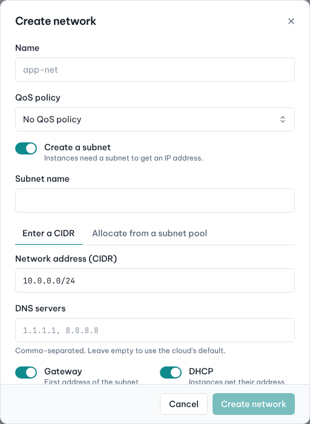
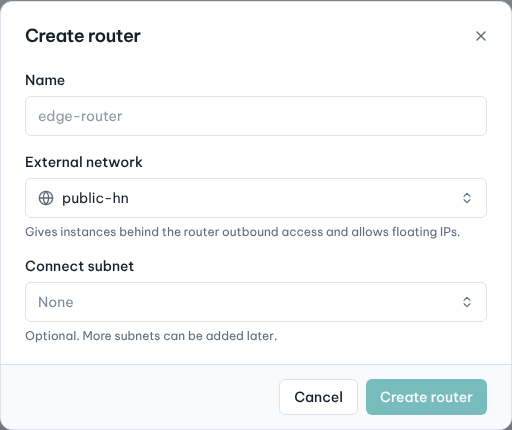
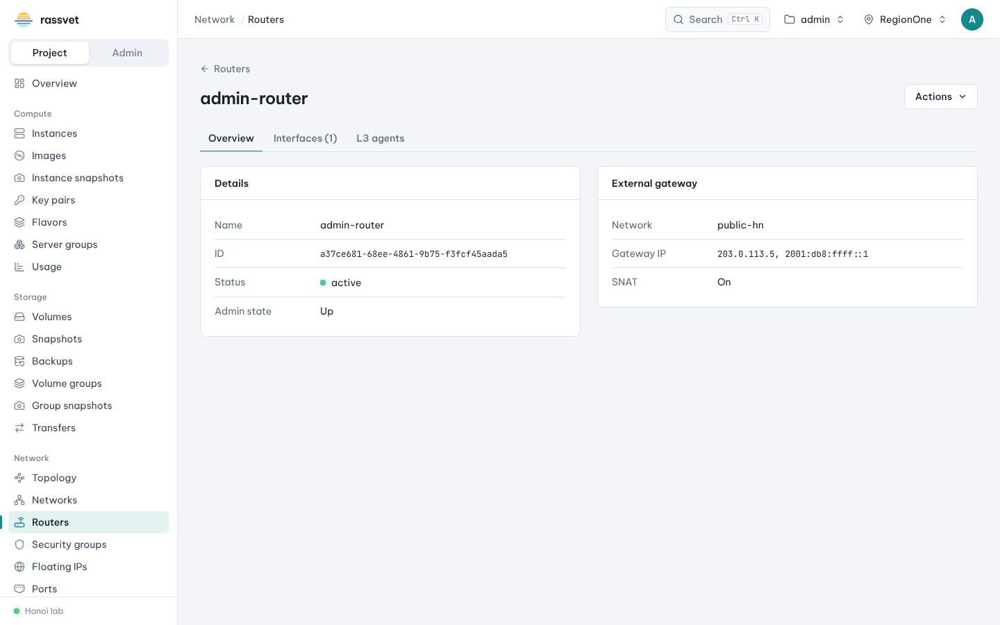
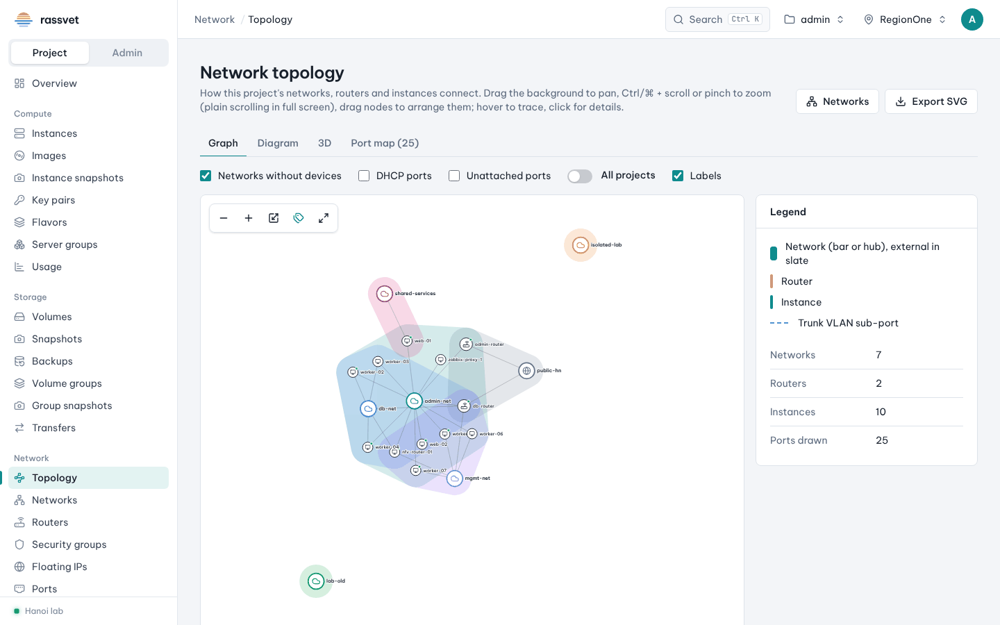

# Networks and routers

## Use case

You want a private network for your instances that can still reach the internet and accept floating IPs —
the classic "private subnet behind a router" setup:

```
instances ── my-net (10.20.0.0/24) ── my-router ── external network (public)
```

## 1. Create the network and its subnet

1. Go to **Network → Networks** and click **Create network**.
2. Enter a **Name**, e.g. `my-net`.
3. Keep **Create a subnet** on (instances need a subnet to get an IP address) and fill in:
   - **Subnet name**, e.g. `my-net-v4`;
   - **Network address (CIDR)**, e.g. `10.20.0.0/24` — or choose **Allocate from a subnet pool** if your cloud
     offers pools;
   - **DNS servers** (comma-separated; empty uses the cloud's default);
   - keep **Gateway** and **DHCP** on.
4. Click **Create network**.



The network's page has **Overview**, **Subnets**, **Ports** and **Sharing** tabs. Use **Subnets → Create
subnet** to add more subnets (IPv6, allocation pools, host routes).

## 2. Create a router with an external gateway

1. Go to **Network → Routers** and click **Create router**.
2. Enter a **Name**, choose the **External network** (gives outbound access and allows floating IPs) and, in
   **Connect subnet**, pick the subnet you just created.
3. Click **Create router**.



To connect more subnets later: router **⋮ → Connect subnet** (or the **Interfaces** tab on the router's
page). Other router actions: **Change gateway**, **Clear gateway**, **Disconnect subnet**, **Edit router**,
**Delete router**.



## 3. Launch instances on the network

Choose `my-net` in the **Networks & ports** step of the [launch wizard](02-launch-instance.md), then give the
instance a [floating IP](08-floating-ips.md) if it must be reachable from outside.

## See how everything connects

**Network → Topology** draws your networks, routers and instances:

- **Graph** — networks as hubs; drag nodes to arrange, hover to trace, click for details.
- **Diagram** — networks as vertical bars and devices as rows, one line and IP per port.
- **3D** — the same graph in three dimensions.
- **Port map** — a table of every device, network, IP and MAC.

Zoom with Ctrl/⌘ + scroll or pinch, pan by dragging the background, and use **Export SVG** to save a picture.



## Ports

**Network → Ports** lists every port of the project. Filter by **Attached to** (instance, router, DHCP,
unattached…) and, for instances, by an instance name pattern. Ports can be created in advance (fixed IP, MAC,
security groups) and attached when launching an instance with **Add an existing port**.
