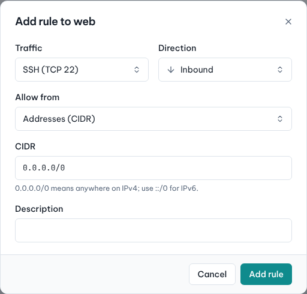
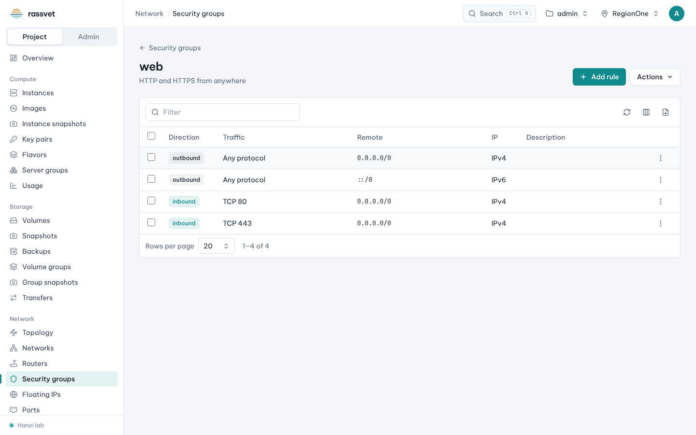

# Security groups

## Use case

Instances block all inbound traffic until a security group allows it. You want to open SSH from your office
and HTTPS from anywhere, without touching the guest's own firewall.

A security group is a set of allow rules applied to an instance's ports. New groups allow all outbound
traffic and no inbound traffic. Every project has a `default` group.

## Create a security group

1. Go to **Network → Security groups** and click **Create security group**.
2. Enter a **Name** (e.g. `web`) and a **Description**, click **Create**.

## Add rules

1. Click the group's name to open it, then click **Add rule**.
2. Choose the **Traffic** preset — *SSH (TCP 22)*, *HTTP (TCP 80)*, *HTTPS (TCP 443)*, *RDP (TCP 3389)*,
   *DNS (UDP 53)*, *MySQL*, *PostgreSQL*, *Kubernetes API*, *WireGuard*, *OpenVPN*, *ICMP (ping)* — or
   *Custom TCP*, *Custom UDP* or *All traffic*.
3. Choose the **Direction** (normally *Inbound*).
4. In **Allow from**, choose **Addresses (CIDR)** and enter one, e.g. `198.51.100.0/24` for your office,
   `0.0.0.0/0` for anywhere on IPv4 or `::/0` for IPv6 — or choose **Instances in a security group** to allow
   every instance that uses another group.
5. Add a **Description** and click **Add rule**.

## Apply it to an instance

- At launch: tick it in the **Security groups** step of the [launch wizard](02-launch-instance.md).
- Later: open the instance, **Actions → Edit security groups**. Changes apply immediately.

## Tips

- Prefer narrow sources for admin ports (SSH, RDP, databases) and `0.0.0.0/0` only for public services.
- To let instances of one tier talk to another (web → database), allow the web group as the source in the
  database group instead of IP ranges.
- Unused groups show up in [Cleanup](13-cleanup.md).
