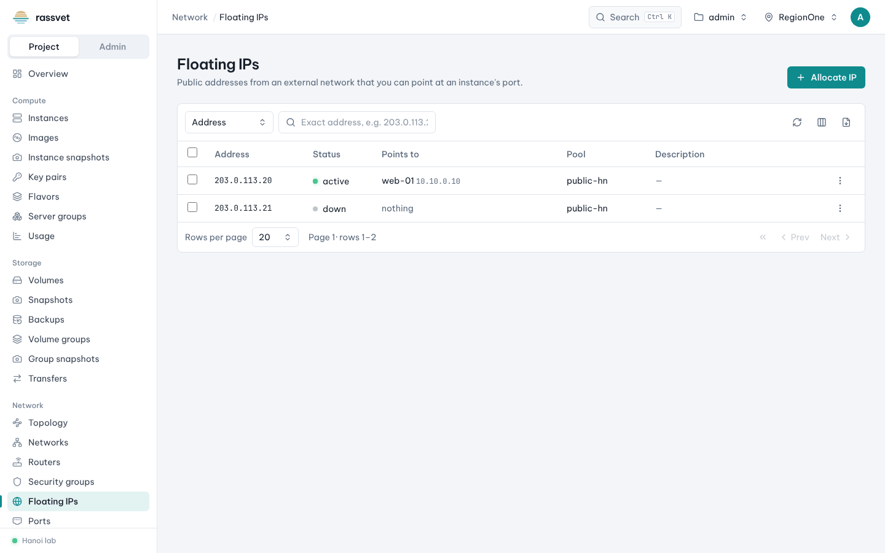
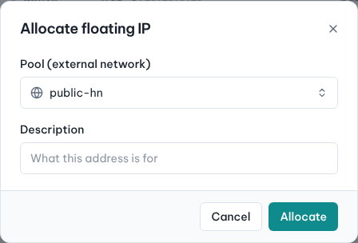

# Floating IPs

## Use case

Your instance has a private address only. To reach it from the internet (SSH, a web site) you give it a
floating IP: a public address from an external network that you can move between instances.

## Allocate an address

1. Go to **Network → Floating IPs** and click **Allocate IP**.
2. Choose the **Pool (external network)**, add a **Description** if you like, click **Allocate**.

## Associate it with an instance

From the floating IP: **⋮ → Associate**, choose the instance's port, confirm.

Or from the instance: **Actions → Associate floating IP**; there you can also **Allocate a new floating IP**
in one go. See [Work with instances](03-manage-instances.md#give-the-instance-a-public-ip).

The instance's network must be behind a router with a gateway on that external network
([Networks and routers](06-networks-and-routers.md)), and a [security group](07-security-groups.md) must
allow the traffic.

## Move or release

- **Associate** again to point the address at another port.
- **Release** returns it to the pool. Floating IPs count against your quota (and are often billed) even when
  not associated — release the ones you don't use. [Cleanup](13-cleanup.md) lists them.
