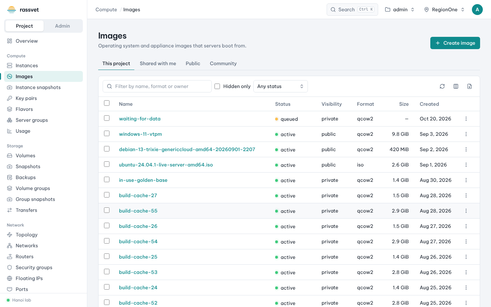
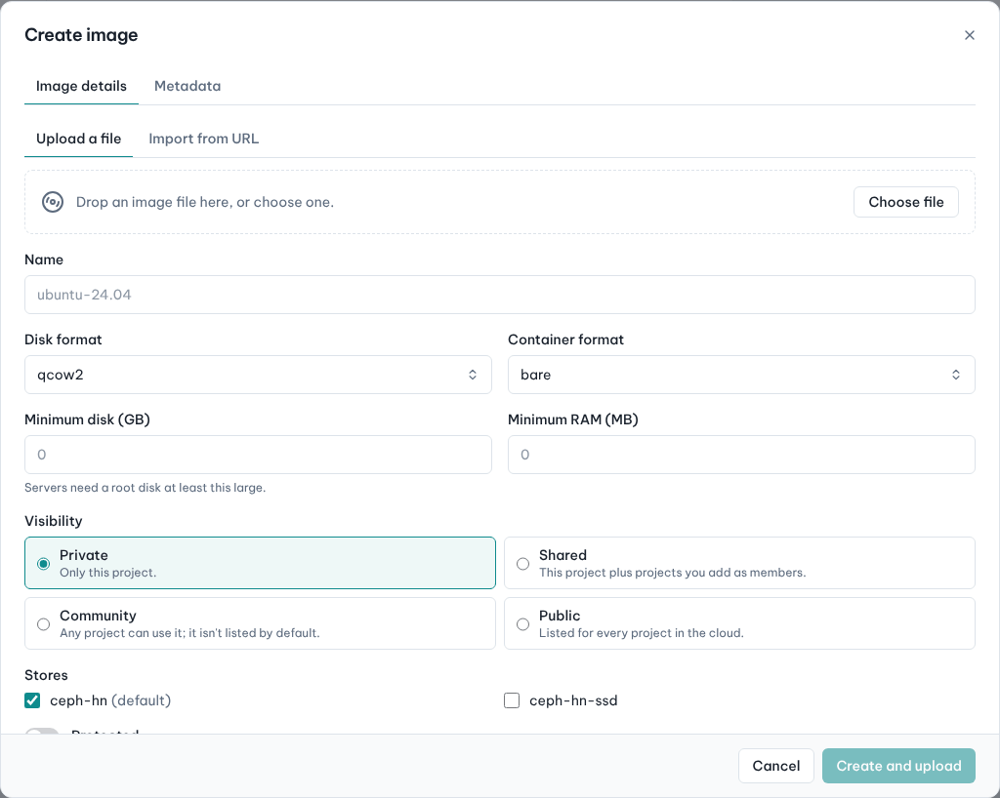

# Images

## Use case

The public images of your cloud don't fit: you need your own golden image (a hardened OS, an appliance, an
ISO installer) and want to share it with a partner project.

The tabs filter by owner: **This project**, **Shared with me**, **Public** and **Community**.

## Upload an image

1. Go to **Compute → Images** and click **Create image**.
2. On **Image details** choose how to get the data:
   - **Upload a file** — drop the file on the dialog or click **Choose file** (large files are streamed, with
     progress in the upload tray at the bottom of the screen; you can keep working meanwhile);
   - **Import from URL** — Glance downloads the file itself, so the URL must be reachable from the cloud.
3. Enter the **Name**, check the **Disk format** (`qcow2`, `raw`, `iso`…) and **Container format** (`bare`).
4. Optionally set **Minimum disk (GB)** and **Minimum RAM (MB)** so nobody launches it on a flavor that is too
   small.
5. Choose the **Visibility**: *Private* (this project), *Shared* (this project plus members you add),
   *Community* or *Public* (public needs the admin role).
6. Optionally open the **Metadata** tab to set properties such as OS type, firmware (`hw_firmware_type=uefi`)
   or the disk bus — suggestions come from the cloud's metadata definitions.
7. Click **Create and upload**.

The image is ready when its status is *active*.

## Share it with another project

1. Make sure the image's visibility is **Shared** (row **⋮ → Edit image**).
2. Open the image; in the **Shared with…** card enter the other **Project ID** (or pick from the
   suggestions) and click **Share**.
3. The other project sees it under **Shared with me** and must **Accept** it before it appears in their launch
   wizard (or **Reject** it).

## Other actions

- **Launch instance** or **Create volume** from the image.
- **Edit image** — name, minimum disk/RAM, tags, **Protected** (prevents deletion), **Hidden** (left out of
  lists, still usable by ID).
- **Edit metadata** and **Download**.
- **Delete image** (turn off *Protected* first).
