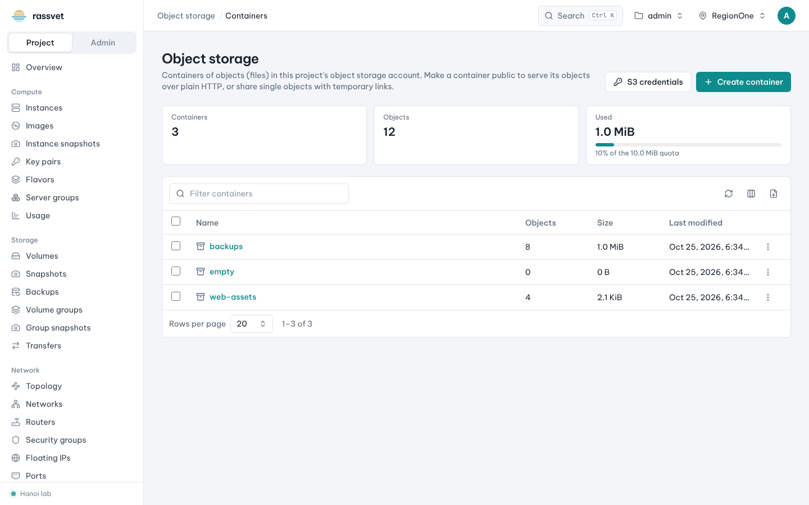
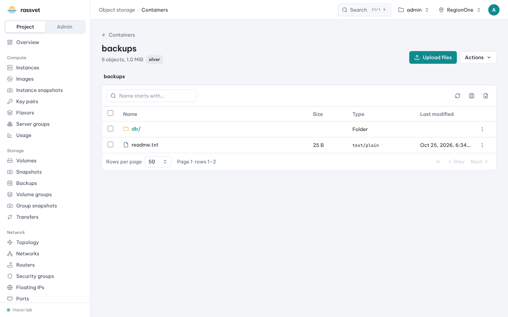
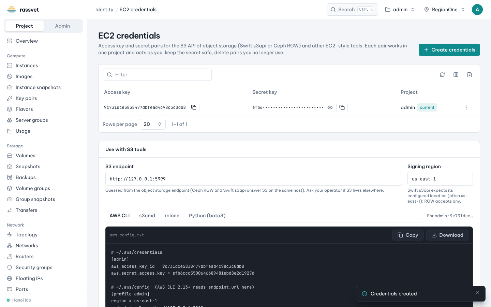

# Object storage and S3

## Use case

You need to keep files — backups, logs, static web assets, datasets — without managing a disk, and reach them
from anywhere: from the browser, by a public or temporary link, or with S3 tools such as `aws`, `s3cmd`,
`rclone` or Python's `boto3`. Rassvet works with OpenStack Swift and Ceph RGW.

## Create a container

A container is like an S3 bucket: a top-level folder of objects.

1. Go to **Object storage → Containers** and click **Create container**.
2. Enter a **Name**. Optionally:
   - **Public** — anyone with the URL can read objects and list the container, without a token;
   - **Storage policy** — where and how the data is stored (replicas, erasure coding, SSD…); can't be changed
     later;
   - **Keep old versions** — overwritten and deleted objects are copied to an archive container first.
3. Click **Create container**.



The page shows how many containers and objects you have and how much of the quota is used.

## Upload and download files

1. Click the container's name to open the file browser.
2. Click **Upload files**, or drag files from your computer onto the page. The **Actions** menu next to it offers
   **Upload a folder**, **New folder**, **Container settings** and **Delete container**.
3. Click a folder to open it; the path at the top takes you back.
4. Each object's **⋮** menu: **Download**, **Properties** (content type and metadata), **Share a temporary
   link**, **Copy public URL** (public containers), **Copy or move**, **Delete object**.



## Share a file with a temporary link

1. In the object's menu choose **Share a temporary link**.
2. Pick how long it is **Valid for** (1 hour, 1 day, 7 days, 30 days) and click **Create link**.
3. Copy the link. It works without signing in, for anyone who has it, until it expires.

## Use S3 tools (EC2 credentials)

S3 clients authenticate with an access key and a secret instead of your password.

1. Go to **Identity → EC2 credentials** (or click **S3 credentials** on the Containers page).
2. Click **Create credentials** and confirm. A new access key / secret pair for the current project appears.
   Use the eye icon to show the secret and the copy buttons to copy each value.
3. Under **Use with S3 tools**, check the **S3 endpoint** (guessed from the object storage endpoint — ask your
   operator if S3 lives elsewhere) and the **Signing region** (`us-east-1` works for most setups).
4. Pick your tool — **AWS CLI**, **s3cmd**, **rclone** or **Python (boto3)** — and **Copy** or **Download**
   the ready-made configuration.



For example, with the AWS CLI configuration saved:

```sh
aws --profile admin s3 ls                       # list containers (buckets)
aws --profile admin s3 cp ./report.pdf s3://backups/
```

Buckets you see through S3 are the same containers you see in Rassvet.

> Anyone holding the access key and secret can read and write the project's object storage as you. Delete
> pairs you no longer use (row **⋮ → Delete**).
