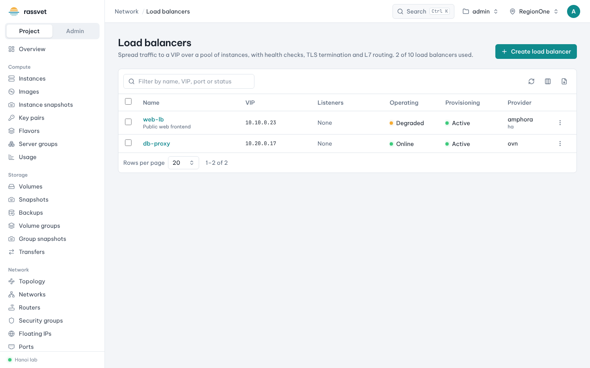
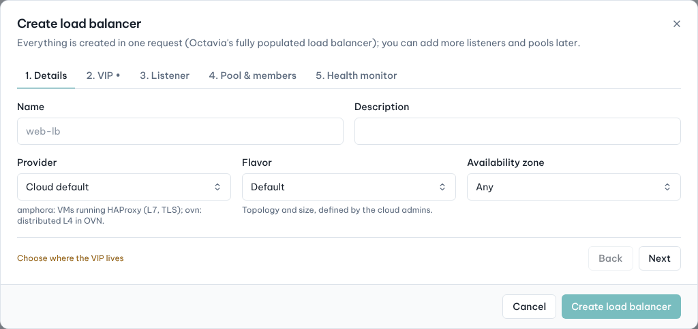
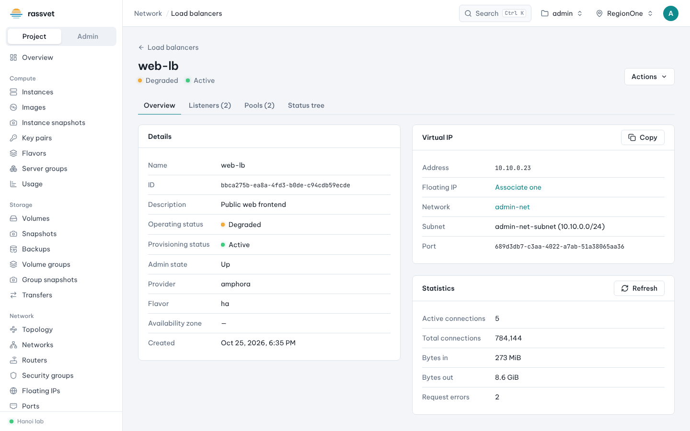

# Load balancers

## Use case

You run the same web application on two or more instances and want one address in front of them that spreads
the traffic, takes failed instances out of rotation and can terminate TLS. Load balancers come from OpenStack
Octavia; the menu entry **Network → Load balancers** appears when your cloud has it.

## Before you start

- Two or more instances serving the application (e.g. nginx on port 80) on the same network.
- A security group on those instances that allows the port from the load balancer's subnet.
- For a public address: the VIP subnet must be behind a router with an external gateway.

## Create a load balancer

Everything is created in one request; you can add more listeners and pools later.

1. Go to **Network → Load balancers** and click **Create load balancer**.
2. **1. Details** — enter a **Name** and optionally a **Description**, **Provider** (*amphora*: VMs running
   HAProxy with L7 and TLS features; *ovn*: distributed L4), **Flavor** and **Availability zone**.

   

3. **2. VIP** — where clients connect: choose the **VIP subnet** (optionally a **Fixed address**) or an
   **Existing port**, and optionally allocate a **Floating IP** for it right away.
4. **3. Listener** — keep **Create a listener** on and set the **Protocol** and **Port** (e.g. HTTP 80).
   For HTTPS termination choose *TERMINATED_HTTPS* and pick the **Certificate** (a Barbican secret or
   certificate container — see the *Key manager* pages).
5. **4. Pool & members** — keep **Create a default pool**, choose the **Pool protocol** and **Algorithm**
   (round robin, least connections, source IP), then add the **Members** (your instances) and the
   **Member port**.
6. **5. Health monitor** — keep **Check member health** on; choose the **Type** (e.g. HTTP), **Interval**,
   **Timeout**, **Retries** and for HTTP the **URL path** and **Expected codes**.
7. Click **Create load balancer**. Provisioning takes a minute; the status becomes *Active / Online*.

## Check and change it

Open the load balancer to see:

- **Overview** — VIP address (**Copy**), floating IP (**Associate one** if it has none), provider, flavor,
  and live **Statistics** (active and total connections, bytes).
- **Listeners** and **Pools** — add, edit or delete listeners, L7 policies, pools, members and health
  monitors. Set a member's weight to 0 to drain it gracefully.
- **Status tree** — the operating status of every listener, pool and member, to spot a failing backend.

