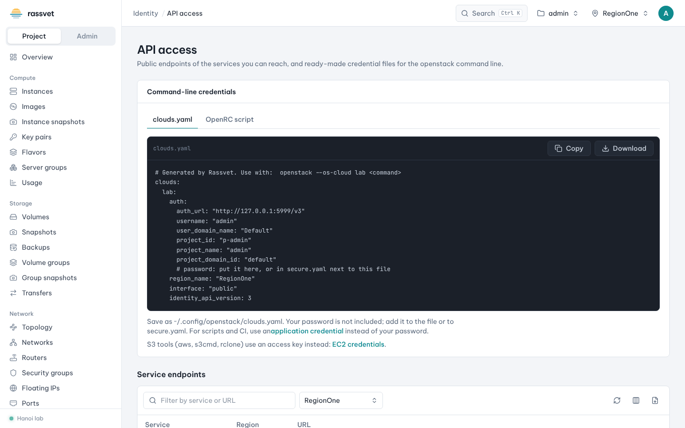

# API access

## Use case

Besides the dashboard you want to use the `openstack` command line, Terraform, Ansible or a CI pipeline
against your project. Rassvet gives you ready-made credential files, and application credentials so that
scripts never need your password.

## Use the openstack CLI with your account

1. Go to **Identity → API access**.
2. In **Command-line credentials** choose the format:
   - **clouds.yaml** — save it as `~/.config/openstack/clouds.yaml`. Your password is not included; add it to
     the file or to `secure.yaml`.
   - **OpenRC script** — run it with `source`; it asks for your password and never stores it.
3. Click **Copy** or **Download**.



```sh
# clouds.yaml
export OS_CLOUD=<cloud name from the file>
openstack server list

# or OpenRC
source admin-openrc.sh
openstack server list
```

Below, **Service endpoints** lists the public URL of every service in each region — useful for SDKs and
tools that need them.

## Create an application credential (for scripts and CI)

An application credential is bound to one project, can expire, can be limited to some of your roles and can
be revoked at any time — without changing your password.

1. Switch to the project the script should use.
2. Go to **Identity → Application credentials** and click **Create credential**.
3. Enter a **Name** and optionally a **Description** and **Expires on** date (empty = never expires).
4. Choose the **Roles** to delegate (only roles you hold in this project). Leave **Unrestricted** off unless
   a tool must create other credentials or trusts.
5. Click **Create credential**.
6. Copy the **Secret** now — Keystone can't show it again. The dialog also offers ready-to-use
   `clouds.yaml` and **OpenRC script** files with the credential filled in. Click **I've saved the secret**.

```yaml
# clouds.yaml for an application credential
clouds:
  ci:
    auth_type: v3applicationcredential
    auth:
      auth_url: https://keystone.example.com/v3
      application_credential_id: "<ID>"
      application_credential_secret: "<secret>"
    region_name: RegionOne
```

To revoke it, delete it from the list. You can also sign in to Rassvet with an application credential
(**App credential** on the sign-in page).

## S3 access

S3 tools use EC2 credentials instead — see [Object storage and S3](10-object-storage.md#use-s3-tools-ec2-credentials).
