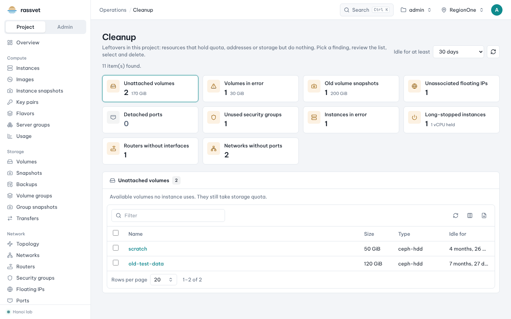

# Cleanup

## Use case

Your quota is full or your bill is higher than expected, but you don't know what is wasting resources:
forgotten volumes, floating IPs nobody uses, instances stopped months ago. **Operations → Cleanup** finds these
leftovers in your project and lets you remove them in bulk.

## What it looks for

| Finding | Meaning | Bulk action |
|---------|---------|-------------|
| Unattached volumes | available volumes no instance uses | Delete (volumes with snapshots are skipped) |
| Volumes in error | create, extend, restore or delete failed | Delete |
| Old volume snapshots | snapshots older than the chosen age | Delete |
| Unassociated floating IPs | public addresses attached to nothing | Release |
| Detached ports | ports with no device; they hold IP addresses | Delete |
| Unused security groups | no port uses them and no other group refers to them (`default` is never listed) | Delete |
| Instances in error | failed to build, move or resize | Delete |
| Long-stopped instances | shut off for long; they still hold vCPUs and RAM | Shelve or Delete |
| Routers without interfaces | connected to no subnet | Delete |
| Networks without ports | nothing plugged in (external and shared networks are not listed) | Delete |

## Steps

1. Go to **Operations → Cleanup**.
2. Set **Idle for at least** (Any age, 1, 7, 30, 90, 180 or 365 days; default 30). Resources used or changed
   more recently are not listed.
3. Each card shows how many items it found (and how much storage or how many vCPUs they hold). Click a card to
   see its list below.
4. Review the list — open an item by its name if you're unsure what it is.
5. Tick the items to remove (or the header box for all), then click the bulk action (**Delete**, **Release**
   or **Shelve**) and confirm. The result dialog shows each item's outcome and the reason for any skipped item.

> Deleting is permanent. Volume data, snapshots and released addresses can't be recovered. When in doubt,
> shelve instances instead of deleting them.
