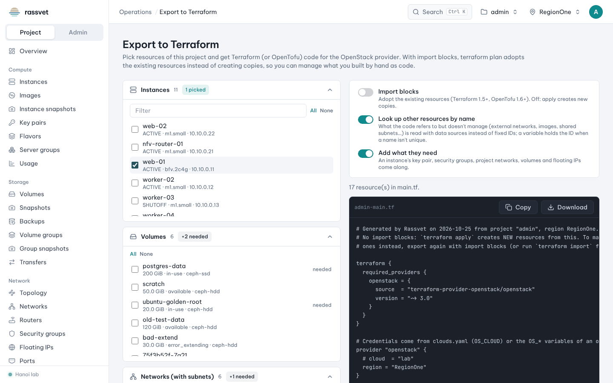

# Export to Terraform

## Use case

You built an environment by hand in the dashboard — instances, volumes, networks, a router, security groups —
and now want to manage it as code, or reproduce it in another project. **Operations → Export to Terraform**
writes the Terraform (or OpenTofu) code for the resources you pick.



## Steps

1. Go to **Operations → Export to Terraform**.
2. On the left, tick what to export in each section: **Instances**, **Volumes**, **Networks (with subnets)**,
   **Routers (with interfaces)**, **Security groups (with rules)**, **Floating IPs** and **Key pairs**. Use the
   filter box, **All** and **None** in long lists.
3. Choose the options on the right:
   - **Add what they need** (on by default) — an instance's key pair, security groups, project networks,
     volumes and floating IPs come along; they are marked *needed*.
   - **Look up other resources by name** (on by default) — things the code refers to but doesn't manage
     (an external network, an image, a shared subnet…) are read with Terraform `data` sources by name instead
     of fixed IDs. When a name isn't unique, a `variable` holds the ID instead.
   - **Import blocks** (off by default) — turn on to adopt the existing resources: `terraform plan` then
     imports them instead of creating new ones (needs Terraform 1.5+ or OpenTofu 1.6+). Leave off to use the
     code as a template that creates new resources.
4. Click **Download** (or **Copy**) to save `<project>-main.tf`.

## Use the code

```sh
mkdir my-env && mv ~/Downloads/admin-main.tf my-env/main.tf && cd my-env
export OS_CLOUD=mycloud          # credentials from clouds.yaml (see API access)
terraform init
terraform plan                   # with import blocks: should list only imports
terraform apply
```

- **With import blocks**, review the plan: it should only import. Attributes the API can't return (user data,
  block devices) are listed under `lifecycle { ignore_changes = [...] }` so the import doesn't plan a rebuild.
- **Without import blocks**, `terraform apply` creates new resources — change names first if you deploy into
  the same project.
- Images looked up by name use the most recent image with that name; `image_id` is ignored after creation so
  a newer upload doesn't rebuild your instances.
