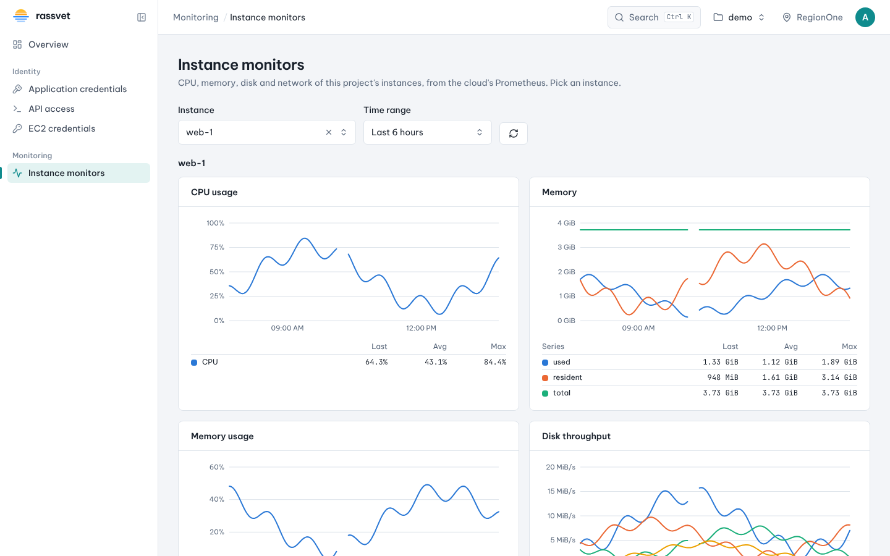

# Instance monitors

## Use case

An application on your instance is slow, or you want to know whether an instance is too big or too small.
**Monitoring → Instance monitors** shows CPU, memory, disk and network charts for each instance in your
project, going back up to 60 days. The menu entry only appears when your cloud has a monitoring system
(Prometheus) connected to Rassvet.

## See an instance's charts

1. Open **Monitoring → Instance monitors**.
2. Pick the instance in **Instance**. The list holds every instance of your current project that has
   metrics in the selected time range, including instances deleted during that range.
3. Pick a **Time range**: a preset from the last hour to the last 60 days, or **Custom range…** with a
   start and an end (no earlier than 60 days ago). Rassvet refreshes the charts every minute, and **↻**
   refreshes them right away.

Point at a chart to see every series' value at that time. Under each chart, a table gives the **last**,
**average** and **maximum** value of each series in the range.

| Chart | What it shows |
|-------|---------------|
| CPU usage | Share of the instance's vCPUs in use (100% = all of them busy) |
| Memory | Memory used inside the guest, resident memory on the hypervisor, and the flavor's memory |
| Memory usage | Memory used as a share of the total |
| Disk throughput / Disk IOPS | Bytes and requests read and written per second, per disk (`vda`, `vdb`…) |
| Disk latency | Average time a read or write took, per disk |
| Disk allocation | Space allocated on the storage and the disk's capacity, per disk |
| Network traffic / packets | Bits and packets received and sent per second, per interface |
| Network errors and drops | Packets lost on the instance's interfaces |

The *Memory used* value needs the guest's memory balloon driver (virtio-balloon, included in most Linux
images). Without it, only the resident memory and the total are shown.

When no instance is picked, the page shows the **project totals**: instances and vCPUs, instance memory,
block storage (volumes and snapshots) and network resources over time.

## What you can see

You only see your current project's instances. To look at another project, switch to it with the project
picker in the top bar. Charts that would show more than eight series (for example, an instance with many
disks) show the eight busiest and say how many were left out.

The page's address holds the instance and time range, so you can send it to a colleague.
